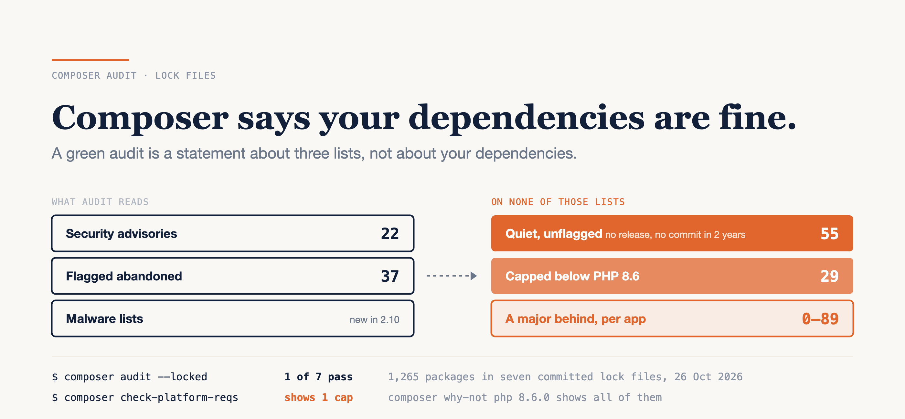

# Composer Says Your Dependencies Are Fine. Here's What It Didn't Check.

### I ran `composer audit` on the committed lock files of seven popular PHP apps. One passed. All seven carry packages nobody has released or committed to in two years, and audit can't see a single one of them.

*Written against Composer 2.10.3 and PHP 8.6.0 RC4, with each app's `composer.lock` as committed on its default branch on 26 October 2026. Advisories and version caps move weekly; the commit for each app is in the sources.*



---

`composer audit` on a healthy project ends with one line: "No security vulnerability advisories found." It's easy to read that line as the whole dependency review. Green check, merge.

I wanted to know what that line covers. So I took the committed `composer.lock` files of seven well-known PHP apps (BookStack, Firefly III, Akaunting, Kimai, Wallabag, Matomo and `symfony/demo`) and ran Composer's own checks against them, without installing anything.

Here's the honest version, up front. Only BookStack passed `composer audit`. The other six failed, mostly on advisories published *after* their lock file was committed, or on packages their maintainers have formally marked abandoned. And BookStack, the clean one, still carries two packages nobody has released or committed to in over two years. Audit doesn't look for those, and it never will.

**A green audit is a statement about three lists, not about your dependencies.**

Below: what audit reads, what the seven lock files carry beyond it, why "quiet" and "abandoned" aren't the same thing, what "a major behind" does and doesn't mean, the PHP 8.6 command that shows you one problem at a time, and a five-step check that takes about a minute per project.

---

## What a clean audit actually certifies

`composer audit` checks the packages in your lock file against lists that somebody has to publish:

- **Security advisories**, from Packagist's advisory API by default.
- **The abandoned flag.** It's a field in a package's own `composer.json`, `"abandoned": true`, optionally naming a replacement. The maintainer sets it.
- **Malware filter lists**, new in Composer 2.10.

The abandoned check fails the build. Since Composer 2.7.0 (February 2024), `audit.abandoned` defaults to `fail`, so a single flagged package makes `composer audit` exit non-zero. Before that it only reported them. Kimai and Matomo both print "No security vulnerability advisories found." as their first line, and then fail on one abandoned package each: `doctrine/cache` and `lox/xhprof`.

Two other details change what "clean" means in practice.

**It's a reading at a point in time.** Of the 22 advisories across the seven lock files, 9 were published after that lock was committed. Firefly III's lock is from 11 October. The advisory it fails on, for `symfony/expression-language`, was published on the 14th. Nobody changed a line, and the audit went red.

**It's configurable, and projects configure it.** Akaunting's `composer.json` sets `audit.block-insecure` to `false` and lists 22 advisory IDs under `audit.ignore`. Firefly III ignores two, each with a reason: "Keys are not generated." Both are reasonable decisions. But they mean a green run in someone else's CI tells you what *their* config allows, not what's in the tree.

One more thing if your CI script reads the exit code. Since 2.10.0 (May 2026), it's 0 or 1. Before, it was 1 for advisories, 2 for abandoned and 3 for both, so a script that branches on `2` changed meaning without anyone touching it.

---

## Seven lock files, one green

Everything below comes from the lock file and Packagist metadata, with no `vendor/` directory. Development packages are included, because audit includes them by default.

| App | Lock committed | Packages | Audit | Advisories | Flagged abandoned | Quiet, unflagged | A major behind (prod) |
|---|---|---|---|---|---|---|---|
| BookStack | 10 Oct | 149 | pass | 0 | 0 | 2 | 7 |
| Firefly III | 11 Oct | 186 | fail | 1 | 1 | 7 | 6 |
| Akaunting | 15 Sep | 223 | fail | 13 | 16 | 12 | 69 |
| Kimai | 25 Oct | 197 | fail | 0 | 1 | 6 | 59 |
| Wallabag | 26 Oct | 270 | fail | 3 | 18 | 22 | 89 |
| `symfony/demo` | 1 Sep | 153 | fail | 5 | 0 | 2 | 5 |
| Matomo | 23 Oct | 87 | fail | 0 | 1 | 4 | 0 |

Across 1,265 locked packages, audit found **37** flagged abandoned. The same lock files hold **55** quiet packages that aren't flagged, so audit is silent about them. That's the column worth explaining.

---

## Quiet is not the same as abandoned

I count a package as **quiet** when its newest release anywhere is more than two years old *and* its GitHub repository hasn't had a push in two years. I exclude `psr/*` interfaces and `symfony/polyfill-*`, which are finished by design, and anything audit already flags.

The abandoned flag is opt-in. A maintainer who walks away without editing `composer.json` leaves nothing for audit to read. The cleanest example is the archived repositories. All of the `hoa/*` packages that Akaunting and Wallabag carry are archived on GitHub *and* flagged, so audit catches them. `behat/transliterator` in Wallabag is archived and not flagged, so audit passes it.

Quiet doesn't always mean dead, though. My first count included `psr/log`, which is finished, not orphaned, and that's why the exclusions above exist. `ralouphie/getallheaders` is quiet in four of the seven apps. Its last release, 3.0.3, is from 8 March 2019. It arrives through one line:

```text
guzzlehttp/psr7 2.13.1 requires ralouphie/getallheaders (^3.0)
```

It's a polyfill for a single PHP function. There may be nothing left to change in it. `dflydev/dot-access-data` is the same kind of case: quiet in four of the seven, last released in July 2024, pulled in by `league/config`.

So the quiet list isn't a list of problems. It's a list of questions audit can't ask for you: is this finished, or is it orphaned? In BookStack that's two packages. In Wallabag it's 22, including three `wallabag/rulerz*` packages the project pins to its own `dev-master` forks, last committed to in December 2023.

---

## A major behind, on purpose or not

`composer outdated` shows a version a major ahead of yours, and audit never mentions it. On each project's own pinned PHP version, the count of production packages with a newer major ranges from **0** (Matomo) to **89** (Wallabag).

The raw number misleads. Kimai's 59 are mostly one decision: 45 are `symfony/*` packages on 6.4 with 7.4 available. Symfony 6.4 is a long-term-support line, with bug fixes until November 2026 and security fixes until November 2027. Being a major behind on an LTS is a plan, not drift. The number that matters is the end-of-life date of the line you're on, which neither audit nor `outdated` prints.

Sometimes the major you're behind on is also the fix for a quiet package. `guzzlehttp/psr7` 3.2.0, released on 17 October, no longer requires `ralouphie/getallheaders`. Moving to it removes the quiet dependency, and staying on 2.x keeps it.

---

## The PHP 8.6 caps, and the command that shows you one

Some packages declare an upper bound on PHP in their `require` section, like `"php": "8.1 - 8.5"`. Audit doesn't read it. With PHP 8.6 due on 19 November, six of the seven lock files hold at least one package that excludes 8.6.0. That's **29** in total, with Matomo at zero.

The obvious check is `composer check-platform-reqs` on an 8.6 image. On every app with a cap, it printed exactly **one** failing `php` line. BookStack has four packages that exclude 8.6, and Kimai has six.

That's by design. In Composer's `CheckPlatformReqsCommand.php`, the loop stops at the first failing requirement for each platform package, under the comment "show the first error from every failed candidate". Fix that one, re-run, and the next one appears.

`why-not` lists them all, and it runs on the PHP you already have:

```bash
$ composer why-not php 8.6.0
# htmlpurifier's constraint shortened: it lists every minor from ~5.6.0 up
ezyang/htmlpurifier  v4.19.1 requires php (~5.6.0 || … || ~8.5.0)
league/oauth2-client 2.9.1   requires php (^7.1 || >=8.0.0 <8.6.0)
nette/schema         v1.3.6  requires php (8.1 - 8.5)
nette/utils          v4.1.5  requires php (8.2 - 8.5)
```

That's BookStack. Across the seven apps there are 20 distinct capped packages. On 26 October, 6 of them had a newer release that allows 8.6. For `nette/schema` that's a `composer update` away: 1.4.0 shipped on 22 October, and `league/config` accepts it with `^1.2`. Others, like `phpoffice/phpspreadsheet`, only lift the cap in a newer major. The other 14 still exclude 8.6 in their newest release, and for those, your 8.6 date is the maintainer's next release.

---

## Playbook: read what audit didn't

### 1. Keep the audit, and read its config

```bash
composer audit --locked
composer config audit
```

`--locked` audits the lock file without a `vendor/` directory. The second command prints your project's audit settings, including every ignored advisory. Each one should have a reason next to it, the way Firefly III's do.

### 2. List what's quiet

```bash
composer show --locked --latest --ignore-platform-reqs --format=json
```

Each package has `latest-release-date` and `abandoned`. Anything with a newest release over two years old and `"abandoned": false` gets one look at its repository: archived, still committed to, or finished by design.

### 3. Count majors, then check the lines' dates

```bash
composer outdated --locked --major-only --no-dev
```

For each framework family in that list, look up the end-of-life date of the line you're on. That date is the real deadline, not the major count.

### 4. Ask the next PHP version the full question

```bash
composer why-not php 8.6.0
```

Not `check-platform-reqs`, which stops at one. For each package listed, check whether its newest release lifts the cap.

### 5. Trace anything surprising

```bash
composer why <package>
```

It tells you whether you chose a package or something you chose did. `ralouphie/getallheaders` and `dflydev/dot-access-data` arrive that way, one level down.

**Estimate:** the whole run, fetching the lock and running every command on two Docker images, took 20 to 63 seconds per app. The reading afterwards scales with the quiet list: two packages for BookStack, 22 for Wallabag.

---

## The limits

Seven apps is not a survey, and every number here is a dated reading of moving lists. I dropped an eighth app from the table because its lock hadn't changed since August 2025. Its 61 advisories alone would have been almost three times the other seven combined. "Two years" is a threshold I chose, and the push date measures activity on a repository, not the health of the one package in it. `behat/transliterator` and `sebastian/resource-operations` are the only archived-but-unflagged packages I found, and the second is a development dependency. Majors were counted against each project's pinned PHP version. With every platform requirement ignored, BookStack's 7 becomes 44.

---

## Verdict

`composer audit` is a good check with a narrow job. It reads advisories, abandoned flags and malware lists, and it reports what's on them.

The lock files say the narrow job leaves most of the maintenance picture to you. Across seven actively maintained projects, unflagged quiet packages outnumber flagged ones, 55 to 37. Every project with a PHP cap had more caps than `check-platform-reqs` showed. And a "major behind" is sometimes a deliberate LTS choice and sometimes a dependency you could have dropped.

So run step 2 on your own lock file this week, and count the quiet packages. If it's a handful, read them today and you know your tree. If it's into double digits, that's a list nobody's audit will ever hand you, and the time to read it is before PHP 8.6 asks you to.

---

### Sources

- [Composer CHANGELOG](https://github.com/composer/composer/blob/main/CHANGELOG.md) — 2.4.0 (`audit`), 2.7.0 (`audit.abandoned` defaults to `fail`), 2.10.0 (malware lists, exit codes), 2.11.0-RC1 — Composer
- [Command-line interface: `audit`, `outdated`, `check-platform-reqs`, `prohibits` / `why-not`](https://getcomposer.org/doc/03-cli.md) — Composer docs
- [Config: `policy` and `audit`](https://getcomposer.org/doc/06-config.md) and [schema: `abandoned`](https://getcomposer.org/doc/04-schema.md#abandoned) — Composer docs
- [`CheckPlatformReqsCommand.php` at 2.10.3](https://github.com/composer/composer/blob/2.10.3/src/Composer/Command/CheckPlatformReqsCommand.php) — GitHub
- [Symfony 6.4 release and support dates](https://symfony.com/releases/6.4) — symfony.com
- [`guzzlehttp/psr7`](https://packagist.org/packages/guzzlehttp/psr7), [`ralouphie/getallheaders`](https://packagist.org/packages/ralouphie/getallheaders), [`nette/schema`](https://packagist.org/packages/nette/schema) — Packagist
- Lock files as tested: [BookStack @ 045c6a9](https://github.com/BookStackApp/BookStack/blob/045c6a98cac21ea86906674bb91d01f375460db6/composer.lock), [Firefly III @ b9c3100](https://github.com/firefly-iii/firefly-iii/blob/b9c31006e8d3008df3d12e23de86b66088c9480e/composer.lock), [Akaunting @ 99b4717](https://github.com/akaunting/akaunting/blob/99b4717d1ad5cd401c1cc737af4c5db8a8488e59/composer.lock), [Kimai @ b484ad4](https://github.com/kimai/kimai/blob/b484ad4ebdcccc4412fb6d2344e3f3a973fcd378/composer.lock), [Wallabag @ 091765a](https://github.com/wallabag/wallabag/blob/091765a99b999cc19aaff568253c72d795c9f93e/composer.lock), [symfony/demo @ 8d2e2ef](https://github.com/symfony/demo/blob/8d2e2ef75c3e18df173d8bf2379a14abb58c4c31/composer.lock), [Matomo @ 5e0a79a](https://github.com/matomo-org/matomo/blob/5e0a79a86784c98fa130968b6f987d33d75622a8/composer.lock)
