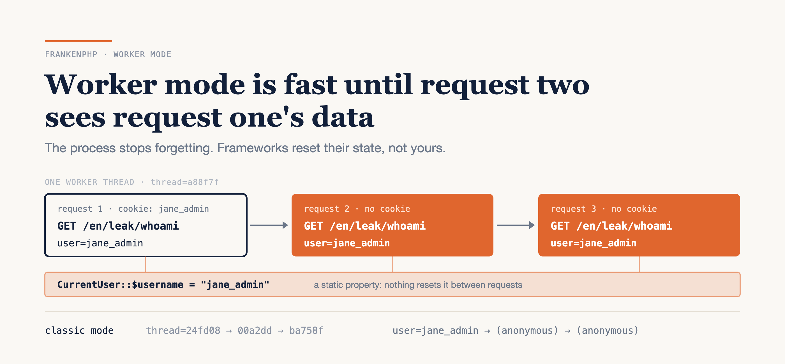

# Worker Mode Is Fast Until Request Two Sees Request One's Data

### I put the Symfony demo app in FrankenPHP's worker mode and planted six ordinary-looking pieces of state. All six reached a different user's request. Symfony's strongest reset option caught two of them.

*Written against FrankenPHP 1.13.3 (PHP 8.5.12), Symfony 8.1 and Laravel Octane 2.22, in October 2026. All three release often, so check the versions before you copy a setting.*



---

I logged in to `symfony/demo` as `jane_admin`, then sent two requests with no cookie at all:

```text
$ curl -b jane.txt localhost:8091/en/leak/whoami
thread=a88f7f user=jane_admin
$ curl localhost:8091/en/leak/whoami
thread=a88f7f user=jane_admin
$ curl localhost:8091/en/leak/whoami
thread=a88f7f user=jane_admin
```

The same app, same code, without worker mode, answers `user=(anonymous)` to both anonymous requests. The only difference is a `worker` directive in the server config.

Here's the honest version, up front. Worker mode skips your framework's bootstrap on every request, which is where its speed comes from, and FrankenPHP has been an officially supported PHP Foundation project since May 2025. But it removes the one property PHP-FPM gave you for free: everything your code left in memory died at the end of the request. Symfony and Laravel reset the state *they* own. Neither can see yours.

**You get worker mode's speed from one line of config. You get its safety only from an audit of your own state.**

Here's what I found: what FPM was quietly doing for you, six leaks reproduced on a real app, the four times this year FrankenPHP itself got it wrong, what the frameworks reset and what they can't, and a five-step audit you can run before you flip the switch.

---

## What FPM was doing for you

Under PHP-FPM every request starts with an empty process state. Statics, singletons, memoized arrays, the default timezone: all gone when the response is sent. That's PHP's share-nothing model, and it's why caching "the current user" in a static property was always safe under FPM: in classic mode, every scenario below comes back clean.

Worker mode boots your app once and then loops. FrankenPHP's own pitch is "Boot your application once and keep it in memory", after which it "will handle incoming requests in a few milliseconds". I didn't measure that, and this post doesn't depend on it. The loop is a single function call:

```php
while (frankenphp_handle_request($handler)) {
    gc_collect_cycles();
}
```

FrankenPHP resets the request superglobals between iterations (`$_GET`, `$_POST`, `$_COOKIE`, `$_FILES`, `$_SERVER`, `$_REQUEST`). Its worker docs then list what persists: static variables, class static properties, globals, in-memory caches, and engine settings changed with `ini_set()`, `date_default_timezone_set()`, `chdir()` and friends. And one line in bold: "**`$_ENV` is currently not reset between requests**."

Turning it on in Symfony 8.1 is a Caddyfile block. No package is needed: FrankenPHP sets `FRANKENPHP_WORKER=1` for worker scripts, and `symfony/runtime` switches to its `FrankenPhpWorkerRunner` when it sees it.

```caddyfile
{
	frankenphp {
		worker {
			file /app/public/index.php
			num 1
		}
	}
}
```

The default `num` is two threads per CPU. I forced it to **one** so every request lands on the same thread. In production the same leak happens on whichever thread served the last user, which makes it intermittent — and harder to reproduce.

---

## Six ways request two sees request one

Every scenario is a few lines added to `symfony/demo`, in prod mode, on `dunglas/frankenphp:1.13.3-php8.5`. Each is a pair of requests: A carries a user, a tenant or a setting; B doesn't. I ran each pair in worker mode and in classic mode.

| # | State | Request B in worker mode |
|---|---|---|
| 1 | Static "current user", set by a subscriber | `user=jane_admin` for an anonymous request |
| 2 | Memoized permission in a service | anonymous `can_edit=true` |
| 3 | Request captured in a service constructor | `client=acme` when B sent `globex` |
| 4 | Static tenant ID, cleared at the end | `tenant=acme`, after A threw a 500 |
| 5 | `$_ENV['LEAK_NOTE']` write | A's value |
| 6 | `date_default_timezone_set()` | a UTC request rendered in `JST` |

In classic mode all six come back clean. Every request also reports a different `thread=` ID, because even the function-local `static` that generates the ID is wiped.

Scenario 1 is the lede, and it's six lines that look entirely reasonable:

```php
public function onRequest(RequestEvent $event): void
{
    if ($user = $this->security->getUser()) {
        CurrentUser::$username = $user->getUserIdentifier();
    }
}
```

Under FPM the missing `else` doesn't matter, because `CurrentUser::$username` starts at `null` on every request. In worker mode it starts at whatever the last logged-in user left.

Scenario 2 looks like ordinary caching:

```php
public function canEdit(int $postId): bool
{
    return $this->canEdit[$postId] ??= $this->security->isGranted('ROLE_ADMIN');
}
```

Jane's `true` is cached on a shared service, and the next anonymous visitor reads it. Scenario 3 is the same mistake one level down: a service that stores `$requestStack->getCurrentRequest()` in its constructor keeps answering with the first request it ever saw. Scenario 4 is the classic "set it, do the work, clear it", with an exception in the middle, so the clear never runs.

Scenarios 5 and 6 are the quiet ones. `date_default_timezone_set()` doesn't look like state. In worker mode it's process state, and the next user's invoice dates are in Tokyo time.

---

## Even the server gets this wrong

If this sounds like an application-developer problem, look at FrankenPHP's own security advisories for 2026. Its threat model (`docs/security.md`) says its job is "to keep one request's data from leaking into another". Four advisories this year are exactly that:

- **CVE-2026-24894** (12 Feb, high): `$_SESSION` data leaking between requests in worker mode.
- **CVE-2026-82416** (18 Jul, high): a session ID handed to a different request when the `session` extension is a shared module.
- **GHSA-996f-w38m-f574** (4 Oct, medium): `putenv()` wrote to the process-wide environment and leaked across requests and threads.
- **GHSA-4gfw-9v29-gp9h** (21 Oct, low): libxml's error list survived the request, so `libxml_get_errors()` could return the previous client's parse errors.

I reproduced the last one. On 1.13.1, a request that parses broken XML is followed by a clean request that still reports `libxml_errors=1 first=Premature end of data in tag invoice line 1`. On 1.13.3 the second request reports zero.

These are maintainers who know the engine better than anyone, finding new per-request state four times in one year. My working assumption is that your own code has some too, and nobody will file an advisory for it.

(If you're on 1.13.1 or older, upgrade regardless: 1.13.2 also rebuilt the images on PHP releases that fix two critical remote-code-execution CVEs.)

---

## What the frameworks reset, and what they can't

**Symfony** resets services, not PHP. On every request after the first, `Kernel::boot()` calls `services_resetter->reset()`, which calls `reset()` on every service tagged `kernel.reset`. Implementing `ResetInterface` adds the tag through autoconfiguration. I wrote scenario 2 a second time with `ResetInterface` and a `reset()` that empties the array: the anonymous request got `can_edit=false`.

Symfony 8.1 added a heavier option, `FRANKENPHP_RESET_KERNEL=1`, which clones the kernel after each request "to mitigate cross-request state leaks". The clone drops the container, so every service is rebuilt. I re-ran all six with it on:

| Scenario | `FRANKENPHP_RESET_KERNEL=1` |
|---|---|
| 2. Memoized service | fixed |
| 3. Captured request | fixed |
| 1, 4. Static properties | still leak |
| 5. `$_ENV` | still leaks |
| 6. Default timezone | still leaks |

That's the shape of every framework reset. It can rebuild objects the container made. It can't touch a static, a superglobal or an engine setting, because those belong to PHP, not to the container.

**Laravel Octane** takes the same approach with listeners. Its default config runs 40 listeners before every request: 32 it also runs before queued tasks and ticks (a sandboxed config, a fresh app instance handed to the router, cache, database, queue and mail managers…) and 8 that are request-only (session, auth, cookies, locale, a fresh request instance…). Container bindings registered with `scoped()` are forgotten after each one. And the Octane docs are candid about the limit: Octane "does not always know how to reset the global state created by your application".

One framing in those docs is worth pushing back on. The static-array example sits under **"Managing Memory Leaks"**. A static that grows is a memory leak. A static that holds a user ID is a data leak, which is scenario 1 above.

---

## The gotcha: `max_requests` is a memory guard, not a fix

Both frameworks restart a worker after **500 requests** by default: Octane's `--max-requests` and Symfony's `FRANKENPHP_LOOP_MAX`. FrankenPHP has its own `max_requests`, still marked experimental and off by default.

It's tempting to read that as a safety net. It isn't. A restart every 500 requests bounds how much memory a leak can eat. It does nothing for request 2 of 500 reading request 1's user.

A smaller one cost me time: don't use `getmypid()` to tell workers apart. In my first probe it returned `1` for every request, because FrankenPHP workers are threads inside one process. Generate a random ID once per worker instead, which is what the `thread=` field above is.

---

## Playbook: audit before you flip the switch

### 1. Grep for statics and engine settings

```bash
grep -rnE 'static (\?|[a-z]+ )?\$|[A-Za-z_]+::\$[a-z_]+ *(\?\?)?=[^=>]' src/
grep -rnE 'date_default_timezone_set|setlocale|ini_set|\$_ENV\[|putenv' src/
```

On the unmodified demo both print nothing. With my scenarios planted they catch 1, 4, 5 and 6. Every hit is a question: can this value differ between users?

### 2. Run a linter built for this

Igor PHP is a static linter for worker mode, and FrankenPHP's own Symfony docs recommend it. Version 0.10.1 audited 49 shared service files in 516 ms. It flagged scenarios 2, 5 and 6, correctly ignored the `ResetInterface` version, and also flagged the demo's own `ControllerSubscriber`, which sets the current controller on a Twig extension every request. It missed 1, 3 and 4. Its precise mode needs its bundle added to `config/bundles.php` and a `dev` cache warm-up first.

### 3. Write the two-request test

Neither grep nor Igor caught scenario 3. Only one thing caught all six: run the server with one worker thread, send request A with a user, send request B without, and assert B sees nothing of A. My driver for all six is 31 lines of shell and `curl`.

Assert on request A too. My first run came back clean on scenarios 1 and 2, and I nearly believed it. The scripted login had failed silently, because the demo uses stateless CSRF tokens that the browser's JavaScript normally generates, so every "logged-in" request was anonymous. A leak test that never had anything to leak proves nothing.

### 4. Fix by kind

- Service state: `ResetInterface` in Symfony, `scoped()` or an Octane `RequestReceived` listener in Laravel.
- Statics: move them into a service the framework resets, or clear them in `finally`.
- Engine settings: pass the timezone or locale explicitly to the call instead of setting a process default.
- `$_ENV`: never write to it at runtime.

### 5. Then turn worker mode on

Keep `max_requests` for memory. Try `FRANKENPHP_RESET_KERNEL=1` on Symfony if you can't fix every service yet, knowing it covers scenarios 2 and 3 and nothing else.

The audit itself is cheap: two greps that finish instantly and a linter that runs in half a second. The fixes are where the time goes, and that depends on how many hits you get.

---

## The limits

One app, and planted bugs: these are scenarios I wrote, not ones I found in the wild. I ran them on Symfony only. The Octane section is from its source and docs, not from a run. One worker thread makes the leaks deterministic; real traffic across many threads makes them rarer and harder to see, not safer. And I didn't measure performance, so this post makes no claim about how much faster worker mode is for your app.

---

## Verdict

Worker mode is fast because the process stops forgetting, and that's also exactly why it's dangerous. The frameworks reset what they built. FrankenPHP resets what PHP's request lifecycle used to, and it's still finding pieces. Your statics, your memoized services and your engine settings are yours to reset.

So before you turn it on, run the two greps above on your `src/`. Zero hits that can hold user data, and a two-request test that passes, means you can turn worker mode on this week. Any hit is a bug FPM was hiding for you, and you'd rather find it with `curl` than in a support ticket.

### Sources

- [FrankenPHP Is Now Officially Supported by The PHP Foundation](https://thephp.foundation/blog/2025/05/15/frankenphp/) — The PHP Foundation
- [Using FrankenPHP workers](https://github.com/php/frankenphp/blob/v1.13.3/docs/worker.md) and [Caddyfile config](https://github.com/php/frankenphp/blob/v1.13.3/docs/config.md) — FrankenPHP docs
- [Security model](https://github.com/php/frankenphp/blob/v1.13.3/docs/security.md) and [security advisories](https://github.com/php/frankenphp/security/advisories) — FrankenPHP
- [FrankenPHP 1.13.2 release notes](https://github.com/php/frankenphp/releases/tag/v1.13.2) — FrankenPHP
- [`FrankenPhpWorkerRunner.php`](https://github.com/symfony/symfony/blob/8.1/src/Symfony/Component/Runtime/Runner/FrankenPhpWorkerRunner.php) and [`Kernel.php`](https://github.com/symfony/symfony/blob/8.1/src/Symfony/Component/HttpKernel/Kernel.php) — Symfony
- [Laravel Octane: Dependency Injection and Octane](https://laravel.com/docs/octane#dependency-injection-and-octane) — Laravel docs
- [`ProvidesDefaultConfigurationOptions.php`](https://github.com/laravel/octane/blob/2.x/src/Concerns/ProvidesDefaultConfigurationOptions.php) — Laravel Octane
- [Igor PHP](https://github.com/igor-php/igor-php) — igor-php
- [`symfony/demo`](https://github.com/symfony/demo/tree/8d2e2ef75c3e18df173d8bf2379a14abb58c4c31) — Symfony, at the commit tested
