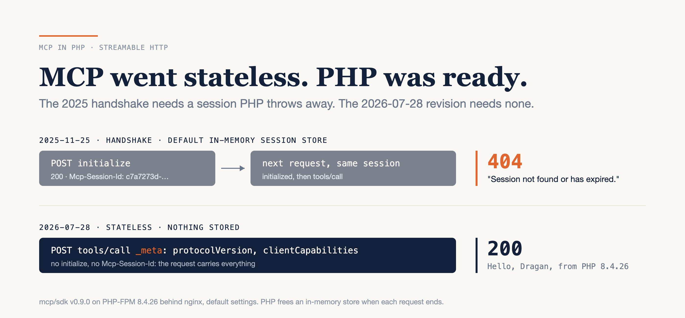

# MCP Went Stateless. PHP Was Ready.

### The official PHP SDK is still pre-1.0, and in July the protocol dropped sessions. I put a Symfony app's blog posts behind MCP, and the hard part was the one PHP never had: remembering a client between requests.

*Written against `mcp/sdk` v0.9.0, `symfony/mcp-bundle` v0.15.0, MCP Inspector 2.12.0 and MCP spec revision `2026-07-28`, on PHP 8.4.26, in October 2026. The SDK is pre-1.0 and ships breaking changes in minor releases, so check its changelog before you copy code.*



---

On 28 July the Model Context Protocol published spec revision `2026-07-28`. Its changelog opens by removing two things: protocol-level sessions, and the `initialize` handshake. That same year PHP got an official MCP SDK, built by the PHP Foundation and the Symfony project. So I built the obvious test: put `symfony/demo`'s blog posts behind an MCP server, then call it from a real client.

Here's the honest version, up front. Writing the tool is one attribute on a PHP method. Serving it over HTTP the 2025 way, with the SDK's default settings, fails on the second request: the server hands out a session, then answers the very next call with `404` and "Session not found or has expired." The new revision doesn't fail, because it doesn't need anything stored at all.

**MCP's stateless revision fits PHP's request model; the session-based one quietly breaks it.**

Here's what I'll cover: what the official SDK is today, a tool that is one method, the same idea on a real Symfony app, the second request that breaks, why the new revision is how PHP already works, and a checklist that gets you from Composer to a verified endpoint.

---

## The official SDK: real, useful, and still pre-1.0

If MCP is new to you, two sentences. An MCP **server** exposes *tools* (functions a model can call), *resources* (data it can read) and *prompts*. An MCP **client** (an IDE, a chat app, an agent) connects to it over stdio or HTTP and speaks JSON-RPC.

The PHP SDK lives at `modelcontextprotocol/php-sdk`, next to the TypeScript and Python ones, and installs as `mcp/sdk`. Its README calls it "a collaboration between the PHP Foundation and the Symfony project". It grew out of `php-mcp/server` and the Symfony AI initiative. It needs PHP `^8.1`.

Be clear-eyed about where it stands. v0.9.0 shipped on 18 October 2026, the thirteenth release in eleven months, and its release notes carry **20** items marked `[BC Break]`. The README calls the SDK experimental until 1.0. MCP's own audit rates it **Tier 3**, which is the experimental tier. Server conformance was 67 of 67 checks, and the client lost points almost entirely on OAuth. For a server, which is what this post builds, that's a good place to be. For anything you pin and forget, it isn't yet.

Two alternatives you'll find on Packagist. `laravel/mcp` is Laravel's own implementation, not built on `mcp/sdk`. It's already 1.x, and its upgrade guide says the server "now speaks protocol revision `2026-07-28` by default". It shows 9.45M monthly downloads, but `laravel/boost`, which requires it, accounts for 8.47M on its own. `php-mcp/server`, the SDK's ancestor, hasn't been pushed to since August 2025. I used Symfony because `symfony/demo` is a real app with real data that anyone can clone.

---

## A tool is a method with an attribute

This is the whole tool:

```php
<?php
namespace App;

use Mcp\Capability\Attribute\McpTool;

class Greeter
{
    /**
     * Greets a person by name.
     */
    #[McpTool]
    public function greet(string $name): string
    {
        return "Hello, {$name}, from PHP " . PHP_VERSION;
    }
}
```

Wire it up with `Server::builder()->setServerInfo('Hello', '1.0.0')->setDiscovery(__DIR__, ['src'])->build()->run(new StdioTransport())`, and pipe JSON-RPC into it. `tools/list` comes back with this:

```json
{"name":"greet","inputSchema":{"type":"object","properties":{"name":{"type":"string"}},
 "required":["name"]},"description":"Greets a person by name."}
```

The docblock became the description, and the signature became the JSON Schema. That mapping is the main thing the SDK does for you, and it's why the method's types and comment are now part of your API. Whatever client connects gets that sentence word for word in `tools/list`, and beyond the schema it's all the client knows about the tool.

`composer require mcp/sdk symfony/finder` is the whole install. `symfony/finder` is only there for the attribute discovery.

---

## Putting a real app behind it

`symfony/demo` is a blog. I gave it one tool and one resource. The tool wraps a repository method the app already had:

```php
// src/Mcp/BlogTools.php, trimmed: the @return docblock and the resource method are cut
final class BlogTools
{
    public function __construct(private readonly PostRepository $posts) {}

    /**
     * Searches published blog posts by words in the title.
     */
    #[McpTool(name: 'search_posts')]
    public function search(string $query, int $limit = 5): array
    {
        return array_map(static fn (Post $p): array => [
            'title' => $p->getTitle(),
            'slug' => $p->getSlug(),
            'author' => $p->getAuthor()->getFullName(),
            'published' => $p->getPublishedAt()->format('Y-m-d'),
        ], $this->posts->findBySearchQuery($query, $limit));
    }
}
```

The resource is a second method in the same class: `#[McpResourceTemplate(uriTemplate: 'post://{slug}', name: 'post', mimeType: 'text/markdown')]` returns a post's Markdown body, and throws `ResourceNotFoundException` for an unknown slug. With constructor injection and both methods, the file is 44 lines.

`symfony/mcp-bundle` does the wiring: autowiring, a `bin/console mcp:server` command for stdio, and a route for HTTP. Two things didn't happen on their own. Composer configured the bundle "From auto-generated recipe", which registered it and nothing else, so I wrote `config/packages/mcp.yaml` and the route import myself:

```yaml
# config/packages/mcp.yaml
mcp:
    servers:
        default:
            name: 'symfony-demo'
            transports: { stdio: true, http: true }
            http: { path: /mcp }
            registry: '*'

# config/routes.yaml
mcp:
    resource: .
    type: mcp
```

Then the first HTTP request returned a 500: "No PSR-17 server request factory found." The bundle converts Symfony's request to PSR-7 and doesn't install an implementation to do it. `composer require nyholm/psr7` fixed it. On a fresh, already-installed clone, `composer require symfony/mcp-bundle nyholm/psr7` took **18 seconds**, and the app's 53 tests still passed afterwards.

MCP Inspector is the protocol's own debugging client, and its CLI makes a good smoke test:

```bash
npx @modelcontextprotocol/inspector@2.12.0 --cli http://127.0.0.1:8080/mcp \
  --method tools/call --tool-name search_posts --tool-arg query=lorem
```

It came back with the matching post, title, slug, author and date, in both protocol eras.

---

## The second request is where PHP breaks

The bundle works over HTTP because it defaults to a file-based session store. Use the SDK on its own and leave the store unset, as the HTTP example in its protocol-eras guide does, and you get `InMemorySessionStore`. Here's that server behind PHP-FPM and nginx, driven with four `curl` calls the way a 2025-era client would:

```text
# PHP-FPM 8.4.26 + nginx, default session store; responses trimmed
== 1 initialize                        -> 200   Mcp-Session-Id: c7a7273d-…
== 2 notifications/initialized         -> 404   "Session not found or has expired."
== 3 tools/call, same session          -> 404   "Session not found or has expired."
== 4 tools/call, 2026-07-28, no session -> 200  "Hello, Dragan, from PHP 8.4.26"
```

The handshake succeeds, and then the server has forgotten it. Not because a different FPM worker answered: PHP throws away everything a request allocated when that request ends. PHP's built-in server, `php -S`, runs as a single process, and it gives the same 404 on request two.

A real client sees the same thing. MCP Inspector, forced into the old revision with `--protocol-era legacy`, gets `"Session not found or has expired."` with status 404. Switch the server to `FileSessionStore` and all four calls succeed, with one session file on disk.

The SDK does document this. Its sessions guide says "PHP often serves each request in a different process" and tells you to use a shared store. But the default is still in-memory, and **stdio hides the problem completely**. Over stdio the server is one long-lived process, so the in-memory store works. If you develop against a desktop client over stdio and deploy over HTTP, request two in production is the first time the store matters.

The fix is one line in the builder, `->setSession(new FileSessionStore($dir))` on a single host, or `Psr16SessionStore` with Redis behind a load balancer. The better fix is to look at what request four did.

---

## The stateless revision is how PHP already works

Request four didn't initialise anything. It carried everything the server needed inside the request:

```json
{"jsonrpc": "2.0", "id": 4, "method": "tools/call",
 "params": {"name": "greet", "arguments": {"name": "Dragan"},
   "_meta": {"io.modelcontextprotocol/protocolVersion": "2026-07-28",
             "io.modelcontextprotocol/clientCapabilities": {}}}}
```

plus `MCP-Protocol-Version`, `Mcp-Method` and `Mcp-Name` headers, so a proxy can route it without parsing the body. That's the `2026-07-28` revision. The changelog says it directly: "Make MCP stateless: remove the `initialize`/`notifications/initialized` handshake." Servers that need state across calls are told to mint their own handles and pass them as ordinary tool arguments. It's the same move as putting an ID in a hidden form field instead of in `$_SESSION`.

For PHP this is a better fit than a workaround. Every request arrives complete, any FPM worker can answer it, and nothing needs a shared store. The SDK serves both eras from the same endpoint and decides per request, so you don't choose one and lock out older clients. Inspector's `auto` mode picked the new revision against the in-memory server and succeeded.

One difference showed up between the eras. The `search_posts` array came back from the new revision with a `structuredContent` copy as well as the text, and from the old one as text only. That isn't a bug. The older revision only allowed a JSON *object* there, and a PHP list encodes as an array. `2026-07-28` allows any JSON value, and the SDK checks which rule applies before it attaches the copy.

I lost time on my own probe script here, so learn from it. A malformed JSON body came back as `-32022 "Unsupported protocol version"`, listing only the old revisions, because without a readable `_meta` the SDK routes by header to the handshake side. If you see that error, check the body before you blame the server.

---

## Playbook: from Composer to a verified endpoint

### 1. Install

`composer require mcp/sdk symfony/finder` on its own, or `composer require symfony/mcp-bundle nyholm/psr7` in Symfony. Then write `config/packages/mcp.yaml` and the route import yourself.

### 2. Write one tool, and write its docblock for a reader

Plain scalar parameters, a return type, one sentence of description. That sentence goes out verbatim in `tools/list`, so write it for whoever reads it there.

### 3. Prove it over stdio

`php bin/console mcp:server` (or your `run(new StdioTransport())` script), then `tools/list` and `tools/call` from the Inspector CLI.

### 4. Prove it over HTTP, in both eras

Run the same Inspector call twice, with `--protocol-era legacy` and `--protocol-era modern`. A 404 on the legacy run means an in-memory session store. Fix it with `FileSessionStore` or `Psr16SessionStore`, or decide you only serve `2026-07-28`.

### 5. Put the route behind your firewall

It's an endpoint that reads your database. The bundle's routes have stable paths, so an `access_control` entry on `^/mcp` covers it like any other route.

**Estimate:** the parts I timed were 18 seconds of Composer and 44 lines of PHP, plus two YAML files. Steps 3 and 4 are a handful of Inspector runs. The real cost is step 2: deciding which of your app's data a model should be able to reach, and wording it so the model picks the right tool.

---

## The limits

`mcp/sdk` is pre-1.0, and v0.9.0 alone has 20 breaking changes. Pin an exact minor, and read the changelog before every bump. The bundle's 1.0.0-BETA1 tag appeared on 26 October, the day I finished this, with "no significant changes".

Client-side OAuth isn't finished, and on the server side the SDK only acts as a resource server. If you need to issue tokens, that's your own authorisation server's job.

I verified with MCP Inspector, not with a chat client. Inspector speaks `2026-07-28`, and so does Laravel's own client, by its upgrade guide. I didn't survey the chat apps and IDEs. Any client still on the handshake needs the session store, which is why step 4 tests both eras.

A title search over a demo blog is a toy. Exposing real application data to a model is an authorisation question first and a protocol question second, and this post only answers the second.

---

## Verdict

The protocol moved toward PHP this year.

The official SDK makes a tool one attribute on a method, and a Symfony app needs a bundle, a PSR-7 package and two YAML files on top. The trap is the session the 2025 handshake asks you to keep, which PHP discards at the end of every request. The `2026-07-28` revision drops that session, and PHP never kept one in the first place.

So run the Inspector call against your endpoint twice this week, once with `--protocol-era legacy` and once with `--protocol-era modern`. Two successes mean you're done. A 404 on the legacy run means every older client fails after the handshake, and the fix is one `setSession()` line, or a decision to serve the new revision only.

---

### Sources

- [MCP specification `2026-07-28`: Key Changes](https://modelcontextprotocol.io/specification/2026-07-28/changelog) — modelcontextprotocol.io
- [`modelcontextprotocol/php-sdk`](https://github.com/modelcontextprotocol/php-sdk) and its [v0.9.0 release notes](https://github.com/modelcontextprotocol/php-sdk/releases/tag/v0.9.0) — GitHub
- [PHP SDK: Protocol versions](https://github.com/modelcontextprotocol/php-sdk/blob/main/docs/protocol-versions.md), [Session management](https://github.com/modelcontextprotocol/php-sdk/blob/main/docs/run/sessions.md) and [SDK tier target](https://github.com/modelcontextprotocol/php-sdk/blob/main/docs/sdk-tier.md) — GitHub
- [PHP SDK — Tier 3 Assessment](https://github.com/modelcontextprotocol/modelcontextprotocol/issues/3274) — modelcontextprotocol/modelcontextprotocol#3274
- [`symfony/mcp-bundle` documentation](https://github.com/symfony/ai/blob/main/docs/bundles/mcp-bundle.rst) and [v0.15.0](https://github.com/symfony/mcp-bundle/releases/tag/v0.15.0) — GitHub
- [`laravel/mcp` upgrade guide](https://github.com/laravel/mcp/blob/main/UPGRADE.md) — GitHub
- [MCP Inspector CLI](https://github.com/modelcontextprotocol/inspector/blob/main/clients/cli/README.md) — GitHub
- App used: [symfony/demo @ 8d2e2ef](https://github.com/symfony/demo/commit/8d2e2ef75c3e18df173d8bf2379a14abb58c4c31)
