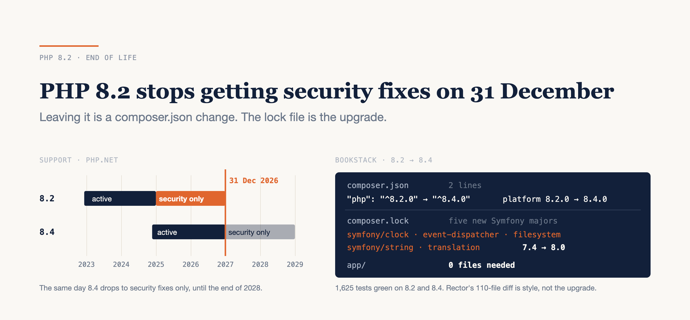

# PHP 8.2 Stops Getting Security Fixes on 31 December

### One Composer install in five still runs 8.2 or older. Leaving it is mostly a config change. Rector won't do the part that's hard.

*Support dates, Packagist figures and package versions as of 26 October 2026; Rector 2.8.1 and BookStack v26.09.1. I'll refresh the Packagist numbers before 31 December.*



---

PHP 8.2.35 came out on 21 October, tagged as a security release. After 31 December there won't be another, and the next CVE in 8.2 stays open.

So I took a real 8.2 app, the BookStack wiki, and moved it to 8.4 to see what the job actually is.

Here's the honest version, up front. If your code already runs cleanly on 8.2, leaving it takes a two-line `composer.json` change and a `composer update`. BookStack's test suite stayed green across the whole move, with the same deprecation count before and after. The surprise was in the lock file, not the code: raising the floor quietly moved five Symfony components to a new major.

**Your PHP 8.2 exit is a dependency upgrade, not a code rewrite, and Rector automates the part you didn't need.**

Below: where the date comes from, who is still on 8.2, which version to aim for, what the bump did to BookStack's lock file, what Rector can and can't do, and a timed five-step playbook.

---

## 31 December is real, and it's already the extended date

php.net's supported-versions table has 8.2 at GA on 8 December 2022, active support until 31 December 2024, and **security support until 31 December 2026**. The newest release is 8.2.35:

```bash
curl -s 'https://www.php.net/releases/index.php?json&version=8.2'
# "version":"8.2.35" … "date":"21 Oct 2026" … "tags":["security"]
```

8.2 got an extra year. In 2024 the Release cycle update RFC changed two things. "Extend Security Support by One Year" passed **31 to 0**. "Extend Releases Cycle to End of Year" passed 33 to 0, so every branch now ends on 31 December rather than on its GA anniversary. The RFC applied both "on all currently supported branches from PHP 8.2", which is why 8.2 is still patched today. Before it, a branch got security fixes for three years from GA.

8.1 went through this a year ago: it ended on 31 December 2025 at 8.1.34.

One more line in that table matters this month. **8.4's active support also ends on 31 December 2026.** From January it gets security fixes only, until the end of 2028.

---

## Who is still on 8.2

Packagist breaks every Composer install down by PHP minor version. I parsed the monthly series from packagist.org/php-statistics:

```text
Share of Composer installs by PHP version, in %

            8.5    8.4    8.3    8.2    8.1   ≤ 8.2
Oct 2024      –    0.2   30.0   31.1   21.2   69.8
Oct 2025    0.5   23.4   32.6   20.9   10.6   43.6
Sep 2026   21.8   34.0   23.0   11.1    4.0   21.1
```

September is the last full month: 5.8 billion installs, **21.1%** of them on 8.2 or older. 10.0% are already on a branch with no security fixes at all, so 8.2 is about to double that group. October so far is a little lower, at 18.6%.

8.2's share has been falling by about 10 points a year. If that holds, roughly one install in ten will still be on 8.2 on 1 January. That's a projection, not a measurement.

Read these numbers as builds, not servers. Packagist counts `composer install` runs, so a pipeline that installs fifty times a day counts fifty times. They still say a fifth of the ecosystem's builds run a PHP that is out of support or about to be.

---

## Pick 8.4, not the newest

PHP 8.6 is scheduled for GA on 19 November, so the obvious move is to jump straight to it. For most apps I wouldn't.

8.4 has security fixes until 31 December 2028. It has been out since November 2024, and it's the biggest slice on Packagist at 34%, so your dependencies have had nearly two years to declare support for it. A release a few weeks old is different. Some packages declare an upper bound on `"php"`, the versions their maintainers have tested, and Composer won't install them on anything newer. BookStack's lock has `nette/schema` v1.3.6, which says `"8.1 - 8.5"`; v1.3.7 lifted that on 20 October. Each cap like that is lifted by one maintainer's release. On 8.4 you aren't waiting on anyone's.

8.5 is a reasonable alternative if you want the extra year: security support to the end of 2029. The case for going straight to 8.6 is a small service with few dependencies, where `composer check-platform-reqs` on the 8.6 image comes back clean. Run it and find out.

---

## The floor is config. The lock file is the upgrade.

BookStack raised its own minimum from 8.2 to 8.3 on 4 October 2026, in commit `ac89927af`, "PHP: Updated min version to 8.3". It changed four CI workflow files, `dev/docker/Dockerfile`, `phpstan.neon.dist`, two lines of `composer.json` and 139 lines of `composer.lock`. **No file under `app/` changed.**

I went one step further on the tagged release, v26.09.1, which requires `"php": "^8.2.0"` and pins `config.platform.php` to `8.2.0`. First, can the existing lock run on 8.4?

```bash
composer check-platform-reqs --lock    # on PHP 8.4.26: exit 0
```

Yes. Then raise the floor:

```bash
composer config platform.php 8.4.0
composer require --no-update 'php:^8.4.0'
composer update --dry-run
# Lock file operations: 1 install, 48 updates, 0 removals
```

48 updates sounds like the 8.4 move, but most of it isn't. The same dry run without the bump gives 45, which are just the routine updates since the lock was written. The difference is what to look at:

```text
                            with ^8.4          without
symfony/clock               7.4.8  → 8.0.8     7.4.8  → 7.4.21
symfony/event-dispatcher    7.4.17 → 8.0.15    (stays)
symfony/filesystem          7.4.18 → 8.0.15    7.4.18 → 7.4.21
symfony/string              7.4.19 → 8.0.15    7.4.19 → 7.4.21
symfony/translation         7.4.17 → 8.0.14    (stays)
socialiteproviders/manager  4.9.2  → 4.10.0    (stays)
```

Symfony 8.0 requires `php >=8.4`, and 7.4 requires `>=8.2`. While the floor said 8.2, Composer couldn't choose 8.0. Raise the floor, and it can and does: **five new Symfony majors** arrive in a commit whose message says "bump PHP". Nobody chose them, and the person reviewing the lock diff probably won't spot them.

In BookStack's case it didn't matter. I ran the 1,625-test suite with `error_reporting=-1` and deprecations logged to a file three times: 8.2.35 with the original lock, 8.4 with the original lock, 8.4 after the real update. All green. All three logged the same **162 deprecation lines, 6 distinct messages**. 8.4 added nothing.

Your app may not be so lucky. Read the bump's dry run against the no-bump dry run before you merge.

---

## Rector: what it automates, and when to run it

Rector has a set for each PHP version, up to `php86` today. The documented way to use them reads your target from `composer.json`:

```php
return RectorConfig::configure()
    ->withPaths([__DIR__ . '/app'])
    ->withPhpSets();   // follows "require.php" in composer.json
```

I dry-ran Rector 2.8.1 over BookStack's `app/`, 522 files, with each target from `php82` to `php86`:

```text
Target   Files changed   New rules vs. the line above
php82    110             17 rules (see below)
php83    110             none
php84    110             new without parentheses (21)
                         array_any() (2)
php85    110             none
php86    110             none
```

The 17 `php82` rules are led by closures to arrow functions (45 hits), constructor promotion (22), unused catch variables (21) and `??=` (20).

The `php82` row is the surprise. 110 files change before you target anything newer than you already run, all of it 7.4- and 8.0-era style the project never adopted. None of it is needed for 8.2 or for 8.4. Moving the target four versions up adds two rules.

Here's one of those two, from `app/Activity/Tools/CommentTree.php`:

```php
// before: runs on 8.2
foreach ($this->comments as $comment) {
    if (userCan(Permission::CommentUpdate, $comment)) {
        return true;
    }
}
return false;

// after the php84 set: needs 8.4
return array_any($this->comments, fn($comment) => userCan(Permission::CommentUpdate, $comment));
```

That's the gotcha. **The `php84` set doesn't get you to 8.4. It assumes you're there.** `array_any()` doesn't exist before 8.4, and `new BookContents($page->book)->getTree()` without the outer parentheses is a parse error on 8.3. Apply it while one server still runs 8.2 and you've broken production. Run it after the floor is raised and deployed, as its own pull request, and review the 110 files of style separately from the upgrade.

The one 8.4 deprecation Rector genuinely fixes for you is implicitly nullable parameters (`ExplicitNullableParamTypeRector`, in the `php84` set). BookStack didn't need it.

---

## What Rector can't see

The biggest deprecation in BookStack's log isn't new, and Rector didn't touch it. 129 of the 162 lines are this one, from `app/Entities/Models/Page.php:120`:

```text
urlencode(): Passing null to parameter #1 ($string) of type string is deprecated
```

The code is `urlencode($this->book_slug ?? $this->book->slug)`. Whether that's null depends on the data at runtime. The deprecation dates from 8.1, so it has been in the log the whole time, and no PHP-version set rewrites it.

The rest of what decides your upgrade isn't PHP source at all:

- **Extensions.** 8.4 unbundled IMAP, OCI8, PDO_OCI and pspell to PECL (`UPGRADING`, section 8). If your image compiles any of them, its build changes. `php -m` on the current image tells you.
- **Behaviour changes on runtime values.** 8.3 changed `range()`: a string digit as one bound now gives a list of characters, and several argument shapes now warn or throw. It also deprecated `++` and `--` on non-numeric strings. Neither shows up until a value arrives.
- **The 8.4 `E_STRICT` and `E_USER_ERROR` deprecations.** I found no Rector rule for either in 2.8.1.
- **`vendor/`, the base image and `php.ini`.** Rector processes your paths, not your dependency tree.

---

## Playbook: off 8.2 before the last patch

Timed on BookStack v26.09.1, moving from 8.2 to 8.4.

### 1. Check what production actually runs

```bash
php -v && php -m
```

Run it in the production image, not on your laptop. If PHP there comes from your distribution's packages (`dpkg -l 'php8.2*'` lists them on Debian), read the limits section first. Note any of `imap`, `oci8`, `pdo_oci` or `pspell` in the extension list. One second.

### 2. Ask whether your current lock runs on the target

```bash
composer check-platform-reqs --lock
```

Run it on the 8.4 image. Exit 0 means every locked package accepts 8.4. One second.

### 3. Raise the floor and read the difference

```bash
composer config platform.php 8.4.0
composer require --no-update 'php:^8.4.0'
composer update --dry-run
```

Then run the same dry run on a clean checkout, without the bump, and compare. Whatever appears only in the first list came with the bump. For BookStack that was six packages, five of them Symfony majors. Four seconds; the real `composer update` took 20.

### 4. Run the suite with every deprecation visible

```bash
php -d error_reporting=-1 -d display_errors=0 vendor/bin/phpunit
```

Send deprecations to a log file, then `sort | uniq -c` it, once on 8.2 and once on 8.4. The count that only appears on 8.4 is your work for this upgrade. Two to five minutes per run for BookStack's 1,625 tests.

### 5. Rector last, in its own pull request

```bash
vendor/bin/rector process --dry-run
```

Use `withPhpSets()` with no arguments, after the floor change is merged and deployed. Between 15 seconds and two minutes on 522 files, depending on the cache.

**Estimate:** for an app that runs cleanly on 8.2, the machine time is about ten minutes. The human time is reviewing a lock diff with new majors in it. I'd budget an afternoon. If step 4 shows new 8.4 deprecations in your own code, add the time to fix them. If step 2 or 3 fails, your date depends on a maintainer's release, not on you.

---

## The limits

One app is not a survey, and BookStack already ran cleanly on 8.2. A codebase that doesn't has a bigger job, which this post doesn't size. A test suite only sees what it covers, so treat "same 162 lines" as a floor, not proof.

Packagist counts installs, not servers. And if you run your distribution's PHP, php.net's date may not be yours: Debian 12 ships `php8.2`, and Debian 12's LTS runs to June 2028. Whether those packages keep getting patched is your distribution's call. Check its security tracker.

---

## Verdict

PHP 8.2's last security release is weeks away, and leaving it is smaller than it sounds.

BookStack's move was configuration plus a lock file, and its suite didn't notice the difference. The real risk was the five Symfony majors that slipped in under a version bump. Rector's 110-file diff, which looks like the upgrade, wasn't needed at all, and its 8.4 rules only work once you're already there.

So this week, on a branch, set `"php": "^8.4.0"` and run `composer update --dry-run` next to a dry run without the change. If the two lists match apart from routine patches, leaving 8.2 is an afternoon and a deploy. If the bump pulls in new majors, or doesn't resolve at all, that list is your real upgrade, and you have until 31 December to work through it.

---

### Sources

- [Supported versions](https://www.php.net/supported-versions.php) and [unsupported branches](https://www.php.net/eol.php) — php.net
- [PHP 8.2.35 release announcement](https://www.php.net/releases/8_2_35.php) — php.net
- [RFC: Release cycle update](https://wiki.php.net/rfc/release_cycle_update) — wiki.php.net
- [PHP version statistics](https://packagist.org/php-statistics) — Packagist
- [`UPGRADING` for PHP 8.3](https://github.com/php/php-src/blob/PHP-8.3/UPGRADING) and [for PHP 8.4](https://github.com/php/php-src/blob/PHP-8.4/UPGRADING) — php-src
- [RFC: Unbundle ext/imap, ext/pspell, ext/oci8](https://wiki.php.net/rfc/unbundle_imap_pspell_oci8) — wiki.php.net
- [Set lists and `withPhpSets()`](https://getrector.com/documentation/set-lists) — Rector docs; [Rector 2.8.1](https://github.com/rectorphp/rector/releases/tag/2.8.1) — GitHub
- [`symfony/string` versions and PHP requirements](https://packagist.org/packages/symfony/string) — Packagist
- [`config.platform`](https://getcomposer.org/doc/06-config.md#platform) — Composer docs
- [`nette/schema` releases](https://packagist.org/packages/nette/schema) — Packagist; [PHP 8.6 release schedule](https://wiki.php.net/todo/php86) — wiki.php.net
- [BookStack v26.09.1](https://github.com/BookStackApp/BookStack/releases/tag/v26.09.1) and [commit `ac89927af`](https://github.com/BookStackApp/BookStack/commit/ac89927af) — GitHub
- [`php8.2` in Debian bookworm](https://packages.debian.org/bookworm/php8.2) — Debian; [Debian release dates](https://endoflife.date/debian) — endoflife.date
