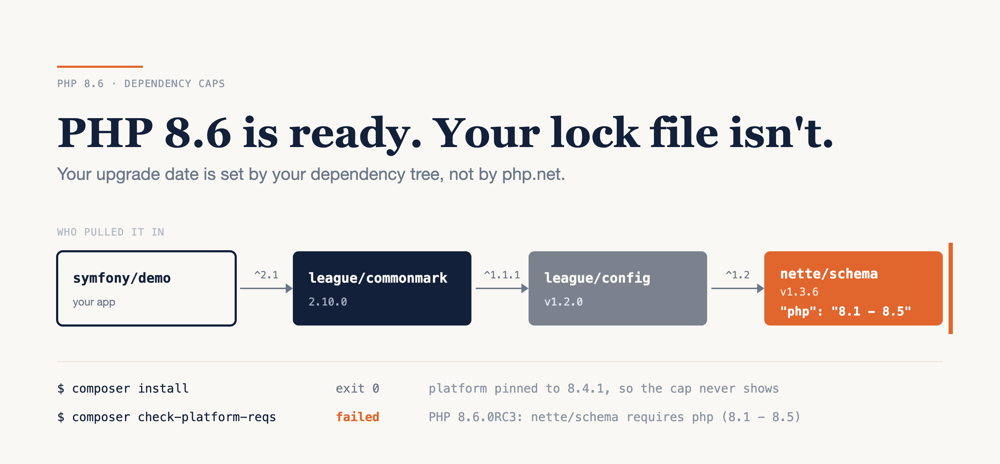

# PHP 8.6 Is Ready. Your Lock File Isn't.

### I tried three real PHP projects on the 8.6 release candidate. Every one of them depends on a package that says it doesn't support 8.6 — and `composer install` won't tell you.

*Written against PHP 8.6.0 RC3 and the package versions current on 18 October 2026. Version caps get lifted quickly near a release; I'll re-check every one at GA on 19 November.*



---

PHP 8.6 goes GA on 19 November, and RC3 landed on 8 October. That's the point where "how long will the upgrade take?" stops being hypothetical, so I tried it on three real projects: `symfony/demo`, the BookStack wiki (a Laravel 12 app with 1,625 tests), and `league/commonmark`. Same extensions, `php:8.4-cli` against `php:8.6.0RC3-cli`.

Here's the honest version, up front. Two of the three test suites passed on 8.6 unchanged, and the language itself broke one code path in the third. What stands between those projects and 8.6 is a `"php": "8.1 - 8.5"` line in a package none of them requires directly, a framework that fixed 8.6 only in its next major, and a session change documented as a deprecation that is actually a warning.

**Your upgrade date is set by your dependency tree, not by php.net.** And the first signal costs about a second per project, weeks before GA.

Here's what I found: the version cap your platform pin hides, the warning that turns a 403 into a 500, the framework that fixed it one major later, what BookStack's suite did when I pushed past all of it, the Docker image surprise, and a five-step check you can run this week.

---

## The first wall is a version cap you didn't know you had

`symfony/demo` and BookStack both pin `config.platform.php` in their `composer.json` — `8.4.1` and `8.2.0`. That's good practice: it makes the lock file resolve identically on every machine. It also means `composer install` checks your dependencies against the *pinned* version, not the PHP you're actually running. On 8.6, both installed cleanly: 153 and 150 packages, exit code 0.

Ask Composer the real question and the answer changes:

```bash
$ composer check-platform-reqs
# trimmed to the failing line
php  8.6.0RC3  nette/schema requires php (8.1 - 8.5)  failed
```

That's `symfony/demo`. BookStack fails the same way on `ezyang/htmlpurifier`, whose constraint lists every minor from `~5.6.0` to `~8.5.0` and stops. A fresh `composer update` without the pin fails on all three: "Your requirements could not be resolved to an installable set of packages."

Nobody on the `symfony/demo` team chose `nette/schema`. It arrives through a chain:

```text
symfony/demo        requires league/commonmark ^2.1
league/commonmark   requires league/config ^1.1.1
league/config       requires nette/schema ^1.2
nette/schema v1.3.6 requires php 8.1 - 8.5
```

That same chain blocks `league/commonmark` on its own. It's a library, it doesn't commit a lock file, so every install resolves fresh and fails.

None of this is negligence. Capping at the versions you've tested is a defensible policy, and both `master` branches still carry the cap: `8.1 - 8.5` for `nette/schema`, `~8.5.0` as the last entry for `htmlpurifier`. For `nette/schema` the fix already exists — PR #74, "Add support for PHP 8.6", adds 8.6 to the CI matrix and changes the constraint line to `8.1 - 8.6`. It has been open since **26 August**. For `htmlpurifier` I couldn't find an issue or PR mentioning 8.6 at all.

So the pin isn't lying, exactly. It's answering a different question. Your next `composer update` on 8.6 is when you find out.

`--ignore-platform-req=php+` gets you past this. The `+` ignores only the upper bound, and with it `symfony/demo` resolves on 8.6. Use it to test. Don't ship it: you'd be running code its maintainer explicitly hasn't checked on your runtime.

---

## A deprecation that is really a warning

PHP 8.6 starts moving `create_sid()` and `validateId()` into the contract every session handler has to meet. Today they live on two optional interfaces; in PHP 9.0 `SessionHandlerInterface` itself will require them. That item of the 8.6 deprecations RFC passed **26 to 2**, with 14 abstentions.

The `UPGRADING` file for 8.6 — the one you read before you upgrade — files it under deprecated functionality: "A deprecation is now emitted when implementing SessionHandlerInterface".

The RFC itself proposes a warning for exactly that case. php-src `ext/session/session.c` on the `PHP-8.6` branch calls `zend_error(E_WARNING, …)`. RC3 does exactly what the code says:

```php
<?php
set_error_handler(function ($no, $msg) {
    $name = [E_DEPRECATED => 'E_DEPRECATED', E_WARNING => 'E_WARNING'][$no] ?? '?';
    echo "level=$no $name: $msg\n";
    return true;
});
class H implements SessionHandlerInterface {
    public function open(string $p, string $n): bool { return true; }
    public function close(): bool { return true; }
    public function read(string $id): string|false { return ''; }
    public function write(string $id, string $d): bool { return true; }
    public function destroy(string $id): bool { return true; }
    public function gc(int $max): int|false { return 0; }
}
echo "loaded H\n";
spl_object_hash(new stdClass);
```

```text
level=2 E_WARNING: Class H implementing SessionHandlerInterface is missing the create_sid() method which will be required in PHP 9.0
level=2 E_WARNING: Class H implementing SessionHandlerInterface is missing the validateId() method which will be required in PHP 9.0
loaded H
level=8192 E_DEPRECATED: Function spl_object_hash() is deprecated since 8.6, consider using spl_object_id() instead
```

On 8.4 the same script prints only `loaded H`.

The difference matters because frameworks treat the two levels differently. Laravel logs deprecations and moves on. Warnings it promotes to `ErrorException`. The warning fires when the class is *loaded*, so the exception goes off wherever the autoloader first touches the handler, which can be in the middle of a request.

### The 403 that became a 500

In BookStack, that happens in `Tests\Activity\AuditLogApiTest`. A request that should be refused with 403 gets this instead:

```text
Expected response status code [403] but received 500.

ErrorException: Class Illuminate\Session\ArraySessionHandler implementing
SessionHandlerInterface is missing the create_sid() method which will be
required in PHP 9.0
```

`ArraySessionHandler` is Laravel's in-memory session driver, the one BookStack's `phpunit.xml` selects with `SESSION_DRIVER=array`. If your own code implements `SessionHandlerInterface` for Redis, DynamoDB or a database table, check it for both methods before you upgrade. Don't wait for the deprecation log to tell you. It won't. The error log will.

---

## Fixed upstream, one major later

BookStack runs Laravel 12, locked at 12.69.3. On the 12.x branch, as of 18 October, `ArraySessionHandler` still has neither method, and `Container::build()` still does this on line 1112:

```php
$this->buildStack[] = spl_object_hash($concrete);
```

`spl_object_hash()` is deprecated in 8.6 (**26 to 9**, 11 abstentions).

Laravel 13.x has both fixes. The session methods landed in laravel/framework#61469, merged into 13.x on 7 September, and the 13.x container no longer calls `spl_object_hash()`. A broader "[13.x] Experimental supports for PHP 8.6" PR is still open.

That's the general shape, and it isn't specific to Laravel: the 8.6 fix you need may only exist on a branch you haven't moved to yet. For a Laravel 12 app, "upgrade to PHP 8.6" may quietly mean "upgrade to Laravel 13 first", or wait for a backport. Find out which before you put a date in the roadmap.

---

## What happens when you push past it anyway

To see what's behind the gates, I installed each project's dependencies on 8.4 and ran the suites on 8.6. That's what `--ignore-platform-req=php+` would give you, with `error_reporting=-1`.

| Project | Tests | PHP 8.4.26 | PHP 8.6.0RC3 |
|---|---|---|---|
| `symfony/demo` | 53 | OK | OK, no new deprecations |
| `league/commonmark` 2.10.4 | 4,409 | OK | OK, 6 deprecations: `setAccessible()` (deprecated in 8.5), in test code |
| BookStack v26.09.1 | 1,625 | OK | **23 errors, 10 failures** |

Laravel normally throws deprecations away during tests, and BookStack hardcodes the deprecation channel to `null`. I pointed it at a file and set `LOG_DEPRECATIONS_WHILE_TESTING=true`. The log went from **162 lines on 8.4 to 84,447 on 8.6**. That looks like a sprint. It's 11 distinct messages:

```bash
sed -E 's/^\[[^]]*\] [a-z]+\.WARNING: //' storage/logs/deprecations.log \
  | sort | uniq -c | sort -rn
```

**83,887** of those lines are the one `spl_object_hash()` call in `Container.php`, firing on every closure the container resolves. Next come `mb_split()` in Laravel's `Str::studly()` (381 lines — mbregex is deprecated in 8.6), `is_a()` with a string in `intervention/image` (16), and `guzzlehttp/promises` declaring a class named `Is` (1), now that `is` is being reserved as a keyword. BookStack's own code added nothing new. Every 8.6 line came from `vendor/`.

The 33 failures were mostly an artefact, and it took me a while to see it. 30 of them were deprecation text printed into response bodies. CLI PHP displays errors by default, so the `spl_object_hash()` notice landed inside streamed zip exports and image responses, and `ZipArchive` then refused to open what was no longer a zip. With `display_errors=0`, 3 failures were left:

- The session warning turned into a 500, the one above.
- An APNG thumbnail test. Run on its own, it fails on the same session warning. In the full run, nothing in the log explains it, so I'm leaving it as unexplained.
- `test_upload_limit_restricts_attachment_uploads`, which also fails on 8.4 when run alone. It depends on test order, not on 8.6, so I'm not counting it.

So the real 8.6 breakage in a 1,625-test Laravel app is one warning, in one framework class, already fixed upstream, plus one failure I couldn't pin down. It sat behind 83,887 lines of noise from a single other framework line, also fixed upstream.

---

## The image changed too

One more thing that bit me before a single test ran. The official `php:8.6.0RC3-cli` image ships **without `mbstring`**. docker-library dropped PEAR for 8.6 (docker-library/php#1654), and `--enable-mbstring` had been tied to the same switch. `php -m` on the 8.4 image lists it, and on the 8.6 image it doesn't.

And nothing complains. BookStack requires `ext-mbstring`, yet `composer check-platform-reqs` on the stock 8.6 image reports it as "success provided by symfony/polyfill-mbstring". That's worse than a loud failure: you'd be running, and benchmarking, a userland polyfill. Add `docker-php-ext-install mbstring` (and `libonig-dev`) to your Dockerfile. The 8.6 images are also built thread-safe (ZTS) across the board now (docker-library/php#1686). That only matters if you compile or load your own extensions.

---

## Playbook: read your upgrade date before GA

### 1. Ask the real platform question

```bash
docker run --rm -v "$PWD":/app -w /app php:8.6-rc-cli sh -c \
  'php -r "copy(\"https://getcomposer.org/download/latest-stable/composer.phar\", \"/tmp/composer\");" \
   && php /tmp/composer check-platform-reqs'
```

With the image already pulled, it ran in about a second per project, including fetching Composer. Every `failed` line on `php` is a cap.

### 2. Trace each cap to its chain

`composer why -r <package>` shows who pulled it in. Then open that package's `master` `composer.json` and its open PRs. A one-line constraint PR sitting open, like `nette/schema`'s, is a different situation from silence, like `htmlpurifier`'s.

### 3. Check which framework branch carries 8.6

Search the framework's PRs for "8.6", `create_sid` and `spl_object_hash`, and note the base branch of anything merged. That's how you find out whether 8.6 also means a framework major.

### 4. Run the suite past the gate, quietly

```bash
composer install --ignore-platform-req=php+
php -d error_reporting=-1 -d display_errors=0 vendor/bin/phpunit
```

Keep `display_errors` off and send deprecations to a log, or you'll be debugging corrupted response bodies instead of PHP 8.6. On Laravel, set `LOG_DEPRECATIONS_WHILE_TESTING=true` and point `logging.deprecations.channel` at a channel that writes to a file.

### 5. De-duplicate, then attribute

Run the `sort | uniq -c` pipeline above and split the results by path: `vendor/<package>` against your own code. Your own lines are your work for this release. The vendor lines are a list of `composer update`s to wait for.

**Estimate:** step 1 takes about a second per project. Steps 2 and 3 are reading, and how long they take depends on how many caps step 1 prints. BookStack's suite took 75 seconds on 8.4 and about 85 on 8.6. For BookStack, the own-code side of that list was empty. The rest of the cost is whatever step 2 tells you: a `composer update` if every cap has a release, an open-ended wait if one doesn't.

---

## The limits

Three projects is not a survey, and `symfony/demo`'s 53 tests see very little of Symfony. RC3 is not GA: any of these caps may be lifted, and `UPGRADING` may be corrected, before 19 November. A test suite only finds what it covers, so treat every count here as a floor.

The session message itself says the methods will be "required in PHP 9.0". That's the reason to fix the warning now rather than silence it — in 9.0 it stops being a warning.

---

## Verdict

PHP 8.6 is ready. The packages around it, as of today, aren't.

Across three real projects, the language itself broke one code path, and it did that through a warning its own changelog calls a deprecation. Everything else was ecosystem timing: a cap with a fix waiting in an open PR, a cap with no fix in sight, a framework that solved 8.6 one major ahead of the app, and an image that quietly lost an extension. None of it shows up in `composer install`.

So run `composer check-platform-reqs` on the 8.6 RC image this week. No `failed` lines means you can go straight to step 4 today. Any `failed` line means your date is that maintainer's next release — so go find the PR, or open the issue, now rather than in November.

---

### Sources

- [PHP 8.6.0 RC3 available for testing](https://www.php.net/archive/2026.php#2026-10-08-1) — php.net
- [`UPGRADING` on the PHP-8.6 branch](https://github.com/php/php-src/blob/PHP-8.6/UPGRADING) and [`ext/session/session.c`](https://github.com/php/php-src/blob/PHP-8.6/ext/session/session.c) — php-src
- [RFC: Deprecations for PHP 8.6](https://wiki.php.net/rfc/deprecations_php_8_6) — wiki.php.net
- [`nette/schema` composer.json](https://github.com/nette/schema/blob/master/composer.json) and [PR #74: Add support for PHP 8.6](https://github.com/nette/schema/pull/74) — GitHub
- [`ezyang/htmlpurifier` composer.json](https://github.com/ezyang/htmlpurifier/blob/master/composer.json) — GitHub
- [laravel/framework#61469](https://github.com/laravel/framework/pull/61469) and [#61771](https://github.com/laravel/framework/pull/61771) — GitHub
- [docker-library/php#1654: Drop `--with-pear` with PHP 8.6](https://github.com/docker-library/php/pull/1654) and [#1686: all 8.6+ images built ZTS](https://github.com/docker-library/php/pull/1686) — GitHub
- [`check-platform-reqs` and `--ignore-platform-req`](https://getcomposer.org/doc/03-cli.md) — Composer docs
- Projects tested: [symfony/demo @ 8d2e2ef](https://github.com/symfony/demo/commit/8d2e2ef75c3e18df173d8bf2379a14abb58c4c31), [BookStack v26.09.1](https://github.com/BookStackApp/BookStack/releases/tag/v26.09.1), [league/commonmark 2.10.4](https://github.com/thephpleague/commonmark/releases/tag/2.10.4)
