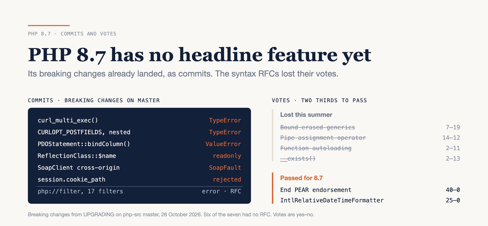

# PHP 8.7 Has No Headline Feature Yet. Its Breaking Changes Already Landed.

### Two months into the 8.7 cycle, master has seven breaking changes, an empty deprecations section, and no new syntax. This summer's four syntax RFCs all lost their votes. Here's what's in, what's voting, and when the door closes.

*Checked against php-src `master` at `219289d8e7` and the PHP RFC index on 26 October 2026. Open votes can move until they close, so every count below carries the date it was read.*



---

PHP 8.6 shipped on 19 November, which makes 8.7 the next release anyone will plan around. If you're hoping it brings generics or a pipe assignment operator, both went to a vote this summer, and both lost.

Here's the honest version. As of today PHP 8.7 adds no new syntax, and the one generics RFC voted this year lost **7 to 19**. What 8.7 does have is a growing list of breaking changes, and almost none of them went to a vote.

That isn't a scandal. It's how the PHP project now works, and it changes what you should be watching. **What PHP 8.7 breaks is decided in commits. What it adds is decided in votes, and so far the votes have mostly said no.**

Here's what's on `master`, how a breaking change gets in without a vote, what's voting now, what lost and by how much, the dates that close the door, and ten minutes a month that keep you ahead of it.

---

## What's on master: seven breaking changes and no new syntax

On 22 September 2026 Matteo Beccati committed `7f8a74fb29`, "master is now for PHP 8.7.0-dev". His mail to the internals list that day opened with "That's it! Feature freeze is on." From that moment, anything merged to `master` is 8.7 material.

The file to read is `UPGRADING`. It's the release notes the core developers write as they go, one bullet per change, sorted into fourteen sections. Section 1 is *Backward Incompatible Changes*, and on 26 October it held seven entries:

| Breaking change in 8.7 | Commit | How it got in |
|---|---|---|
| `curl_multi_exec()` throws `TypeError` when `$still_running` isn't an int | `90a65ec8cb` | pull request |
| Nested arrays in `CURLOPT_POSTFIELDS` throw `TypeError` instead of becoming `"Array"` | `2544d0b7d9` | pull request |
| `PDOStatement::bindColumn()` throws `ValueError` for a column not in the result | `7f1e8cb37b` | pull request |
| Public `$name` / `$class` on `ReflectionClass` and friends are now readonly | `eef0f71aa7` | pull request |
| `SoapClient` refuses a redirect to another origin and throws `SoapFault` | `7b3369c0c2` | pull request |
| `session.cookie_path` / `cookie_domain` reject `;` and line breaks | `b9a0228bd8` | pull request |
| A `php://filter` URL takes at most 16 filters | `ee739e842b` | RFC, voted 30–0 for 8.6 |

The rest of the file is new functions in curl and intl, an `IntlNumberFormatter` class, and a long list of performance work. My favourite is `htmlspecialchars()` returning its input without copying it when nothing needs encoding (`5b765f4b68`).

Section 4, *Deprecated Functionality*, is empty. That's not a sign of a quiet cycle. It's a timing fact, and I'll come back to it in the calendar section.

---

## How a breaking change gets in without a vote

Six of those seven rows came in as ordinary pull requests, each tied to a GitHub issue. None had an RFC. Only the filter limit did, and it's the second half of a change voted for 8.6: a deprecation then, an error now.

Two rules make that legitimate.

The first is old. The BC policy has long said that fixing clearly broken behaviour is "not automatically considered a BC break". The session and `SoapClient` rows are security hardening. Before the fix, `SoapClient` resent your credentials and the request body to whatever host a redirect named. The Reflection row fixes a bug report (GH-24147).

The second is new. In April 2026 the project voted **26 to 5** for a policy RFC by Gina Peter Banyard that exempts input type and value validation from the BC policy altogether. Adding a `TypeError` or a `ValueError` to a bundled function no longer needs a vote. The RFC's argument is that missing validation has caused real security advisories, and it links three of them. The two curl rows and the PDO row are exactly that kind of change.

I think the policy is right. A `TypeError` the day you upgrade beats a function that quietly turns your nested array into the string `"Array"` and posts it. The cost is visibility. The 8.7 breaking list never shows up on the RFC index. It shows up in a text file, one merge at a time.

### The gotcha that will bite someone on your team

`bindColumn()` used to report an unknown column through the PDO error mode, so with `ERRMODE_EXCEPTION` you got a `PDOException`. On 8.7 you get a `ValueError`, which isn't a subclass of it:

```php
try {
    $stmt->bindColumn('missing_column', $value);
} catch (PDOException $e) {
    // PHP 8.6: lands here
    // PHP 8.7: never reached, ValueError goes straight past
}
```

---

## What's voting now

Features still need an RFC and a two-thirds majority of the people with voting rights. Here's what has passed or is voting with 8.7 as its target, as of 26 October:

| RFC | Vote | Status |
|---|---|---|
| End PEAR project endorsement, unbundle PEAR from php-src | **40–0** | accepted 19 Oct, not merged yet |
| `IntlRelativeDateTimeFormatter` | **25–0** | accepted, merged 22 Oct (`c242f17cf4`) |
| `Exception` for invalid characters in `hexdec()` and friends | **24–1** | voting until 1 Nov |
| `Filter\Filter` and `Filter\Flag` enums | **2–10** | voting until 4 Nov |

The third row is the one that will touch real code. PHP 7.4 deprecated passing invalid characters to `bindec()`, `octdec()`, `hexdec()` and `base_convert()`. The plan at the time was an exception in PHP 8. That never happened, so seven minor versions later this is what the functions still do:

```php
var_dump(hexdec('1234-5678'));
// PHP 8.6.0RC4:
// Deprecated: Invalid characters passed for attempted conversion, these have been ignored
// int(305419896)
// PHP 8.7, if the vote holds:
// Fatal error: Uncaught Exception: Invalid characters passed for attempted conversion
```

The dash is dropped silently and you get a number. Note the class: the RFC switched from `ValueError` to a plain `Exception` in version 0.3, on the grounds that bad input isn't necessarily a bug in your program. A `catch (\Error $e)` won't catch it.

These votes aren't formalities. `IntlRelativeDateTimeFormatter` first went to vote in September. Tim Düsterhus voted no, saying the text had changed without a notice to the list, and the author pulled the vote. It came back with enums instead of constants and passed. `PREG_THROW_ON_ERROR` drew a detailed no only after its vote opened, and it's back in discussion with its poll marked as a restart.

Further back in the queue, with 8.7 named as the target: `Io\Terminal`, `Time\Instant` and `Time\Clock`, opt-in JSON comments and trailing commas, a bundled `ext/csv`, and short array variable shorthand. The **Deprecations for PHP 8.7** RFC exists as a draft with three items and no discussion thread yet.

---

## What lost, and by how much

Four syntax proposals went to a vote this summer. All four lost:

| RFC | Yes–No–Abstain | Closed |
|---|---|---|
| Bound-erased generic types | 7–19–10 | 28 Jun |
| `__exists()` magic method | 2–13–7 | 28 Jun |
| Pipe assignment operator | 14–12–7 | 11 Aug |
| Function autoloading (mark 5) | 2–11–1 | 13 Aug |

The pipe assignment row is the one to look at. More people voted yes than no, and it still failed, because an RFC needs a two-thirds majority. I'd call that the bar working as designed, not a broken process.

All four targeted 8.6, so none of them is in 8.7 unless someone brings it back as a new RFC. Primary constructors, literal scalar types and pattern matching with `is` are in discussion with no vote opened. The pattern matching RFC was created on 11 November 2020.

---

## The calendar: when the door closes

Nothing official exists for 8.7 yet. The wiki page that holds each release's timetable, `todo/php87`, returns "This topic does not exist yet". No release managers have been chosen either. The release process says the call for volunteers goes out in early March, with a vote in early April.

The release process does fix the shape, though. Alpha 1 is tagged on the first Tuesday of July and released two days later. Beta 1, which is the feature freeze, ships 42 days after alpha 1, and GA 140 days after. 8.6 followed it to the day: alpha 1 on 2 July 2026, beta 1 and the freeze on 13 August, GA on 19 November. Applied to 2027, the formula gives:

- **Alpha 1:** 8 July 2027
- **Beta 1 and feature freeze:** 19 August 2027
- **GA:** 25 November 2027

Those are my arithmetic, not an announcement.

The date that matters most to you isn't on that list. 8.6's deprecations RFC opened discussion on 22 June 2026 and closed its votes on 10 August, three days before beta 1. **The deprecation list is decided last.** That's why section 4 of `UPGRADING` is empty now, and why it will fill up in summer 2027.

As for PHP 9: the policy says a major version bump needs its own RFC, ideally at least six months before alpha 1, which means early January. There's no such RFC on the index, so the next release is 8.7.

---

## Playbook: track 8.7 in ten minutes a month

### 1. Read the breaking section straight from master

```bash
curl -s https://raw.githubusercontent.com/php/php-src/master/UPGRADING \
  | sed -n '/^1\. Backward/,/^2\. New Features/p' | tail -n +3
```

The `tail` skips the table of contents, which matches the same two headings. On 26 October this printed 42 lines in under half a second.

### 2. Grep your code for this month's entries

```bash
grep -rnE 'php://filter|CURLOPT_POSTFIELDS|bindColumn\(|cookie_(path|domain)|\b(hexdec|octdec|bindec|base_convert)\(|SoapClient' \
  --include='*.php' src/
```

Change `src/` to wherever your code lives. Run it on `vendor/` separately, and expect noise. On BookStack, a Laravel app, it took 2.3 seconds and found 0 lines in `app/` and 188 in `vendor/`, mostly `hexdec()` in UUID and image libraries. A grep can't tell good input from bad, so step 3 is the real check.

### 3. Count the one deprecation that is already voted

Run your suite on 8.6 with deprecations visible and search the output for `Invalid characters passed for attempted conversion`. Every hit is a call that throws on 8.7 if the vote holds. BookStack's full suite on 8.6 RC3 (1,625 tests, about a minute and a half) printed none, so its 188 grep hits are all valid input.

### 4. Run your suite on master in CI

`shivammathur/setup-php` builds nightlies from php-src `master`:

```yaml
- uses: shivammathur/setup-php@v2
  with:
    php-version: '8.7'
```

Mark the job as allowed to fail. Its job is to warn you, not to block a merge.

### 5. Watch the votes

The *In voting phase* section at the top of the wiki's RFC index held two RFCs on 26 October. If an RFC changes code you own, say so in the internals discussion before the vote opens. Afterwards is too late.

Steps 1 to 3 cost about ten minutes a month plus one suite run. Step 4 costs one CI job.

---

## The limits

`master` two months after the branch cut isn't 8.7. Anything can land until 19 August 2027, and with the release managers' blessing after it. The two open votes can still flip before they close. My calendar is computed from policy, not announced. And `UPGRADING` is written by the people who commit, so a change can land without its bullet. The commit log is the ground truth if you need one.

The grep in step 2 only knows about this month's entries. Next month's need next month's grep.

---

## Verdict

PHP 8.7 is a cleanup release so far, and a sharper one than it looks.

The evidence points one way. The features people expect from 8.7 lost their votes this summer, and what passes is small library work that nobody argues with. Meanwhile breaking changes keep arriving through pull requests, for good reasons, in a text file rather than on the RFC index.

So run steps 1 to 3 this week. If both come back empty, 8.7 is a non-event for you so far, and you can look again in March, when the release manager call goes out. If step 3 finds even one `Invalid characters passed` line, you have a change that's already voted. Fix it on 8.6 now, while it's still a deprecation.

---

### Sources

- [Commit `7f8a74fb29`, "master is now for PHP 8.7.0-dev"](https://github.com/php/php-src/commit/7f8a74fb29) and ["PHP 8.6 forked"](https://externals.io/message/132585) — php-src, php-internals
- [`UPGRADING` on `master`](https://github.com/php/php-src/blob/master/UPGRADING) — php-src
- Breaking-change commits: [`90a65ec8cb`](https://github.com/php/php-src/commit/90a65ec8cb), [`2544d0b7d9`](https://github.com/php/php-src/commit/2544d0b7d9), [`7f1e8cb37b`](https://github.com/php/php-src/commit/7f1e8cb37b), [`eef0f71aa7`](https://github.com/php/php-src/commit/eef0f71aa7), [`7b3369c0c2`](https://github.com/php/php-src/commit/7b3369c0c2), [`b9a0228bd8`](https://github.com/php/php-src/commit/b9a0228bd8), [`ee739e842b`](https://github.com/php/php-src/commit/ee739e842b) — php-src
- [PHP RFC index](https://wiki.php.net/rfc) — wiki.php.net
- [Policy RFC: Exempt input type and value validation from BC Break policy](https://wiki.php.net/rfc/policy-exempt-type-value-error-bc-policy) — wiki.php.net
- [RFC: Limit maximum number of filter chains](https://wiki.php.net/rfc/limit-maximum-number-of-filter-chains) — wiki.php.net
- [RFC: End PEAR Project Endorsement](https://wiki.php.net/rfc/end_pear_endorsement) — wiki.php.net
- [RFC: IntlRelativeDateTimeFormatter](https://wiki.php.net/rfc/reldateformatter), [first vote thread](https://externals.io/message/132504) and [second](https://externals.io/message/132830) — wiki.php.net, php-internals
- [RFC: Throw exception for invalid characters in number base functions](https://wiki.php.net/rfc/throw_error_for_invalid_characters_for_number_base) — wiki.php.net
- [RFC: Add Filter\Filter and Filter\Flag enums](https://wiki.php.net/rfc/invalid_filter_options) — wiki.php.net
- [RFC: PREG_THROW_ON_ERROR](https://wiki.php.net/rfc/preg_throw_on_error) and [its vote thread](https://externals.io/message/132426) — wiki.php.net, php-internals
- RFCs that lost: [bound-erased generic types](https://wiki.php.net/rfc/bound_erased_generic_types), [`__exists()`](https://wiki.php.net/rfc/exists-magic-method), [pipe assignment operator](https://wiki.php.net/rfc/pipe_assignment_operator), [function autoloading](https://wiki.php.net/rfc/function-autoloading-five-oh) — wiki.php.net
- [RFC: Deprecations for PHP 8.6](https://wiki.php.net/rfc/deprecations_php_8_6) and [Deprecations for PHP 8.7 (draft)](https://wiki.php.net/rfc/deprecations_php_8_7) — wiki.php.net
- [Release process](https://github.com/php/policies/blob/main/release-process.rst) — php/policies
- [PHP 8.6 timetable](https://wiki.php.net/todo/php86) — wiki.php.net
- [setup-php README, nightly builds](https://github.com/shivammathur/setup-php#nightly-build-setup) — shivammathur/setup-php
