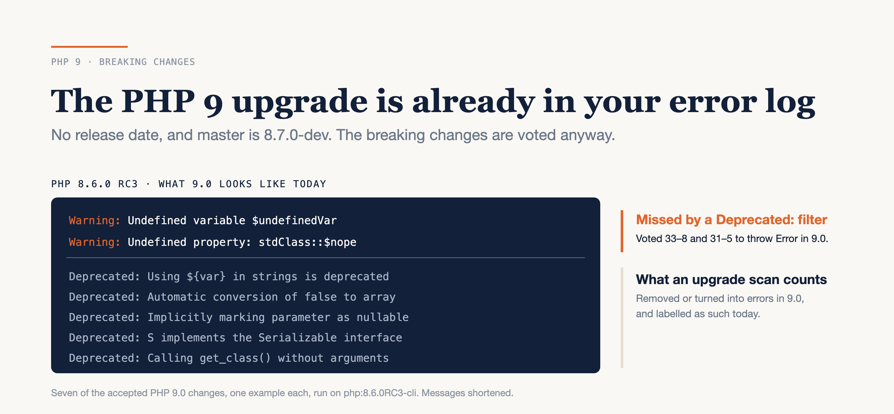

# The PHP 9 Upgrade Is Already in Your Error Log

### PHP 9 has no date and isn't even the next release. Its breaking changes are voted anyway, and two of them print warnings, not deprecations.

*Checked against php-src `master` and the PHP RFC index on 18 October 2026. Error messages are from PHP 8.6.0 RC3. PHP 9.0 has no release date, and anything voted before it ships will land on top of the list below.*



---

Search for "PHP 9 release date" and you'll find posts promising PHP 9.0 later this year, some of them with feature lists nobody has voted on. If you've been planning around one of those, you can stop.

Here's the honest version. Nobody can give you a PHP 9 date, because the next release isn't PHP 9. On 22 September 2026 php-src `master` was bumped to the next version, and the version file now reads:

```c
#define PHP_VERSION "8.7.0-dev"
```

That doesn't mean PHP 9 is vague. Most of its breaking changes were decided years ago, one RFC at a time, and every one of them already does something you can see on PHP 8.6. **PHP 9 is a list you can measure today — and two of its items hide as warnings, not deprecations.**

Here's what "PHP 9" actually is right now, the decisions already made, the two that don't say *Deprecated*, how your framework changes the picture, and how to count your own bill this week.

---

## PHP 9 is a list, not a date

Three places in the PHP project could tell you when 9.0 ships. None of them does.

The source tree says 8.7 is next. The commit is `7f8a74fb29`, "master is now for PHP 8.7.0-dev", and `UPGRADING` on `master` is headed *PHP 8.7 UPGRADE NOTES*.

The php-src issue tracker has a **PHP 9** milestone with no due date and five items in it. The three still open are housekeeping: removing an unused `CONST_CS` flag, removing long-deprecated mbstring INI settings, and turning the resource returned by `proc_open()` into an object.

The RFC index has no RFC about 9.0's timing at all. What it has is a section called *Pending Implementation / Landing*, with **eleven** entries prefixed "PHP 9.0:". Those are accepted changes waiting for a major version to land in. The oldest, phasing out `Serializable`, was created in December 2020.

So PHP 9 isn't an event you wait for. It's a backlog that has been accepting entries for six years, and the release is whenever someone decides to empty it.

---

## The decisions already made

Ten of those eleven entries have a vote behind them. The eleventh, promoting a required parameter after an optional one to an error, links to a php-src pull request from 2020 that was closed without merging, so I'm treating it as an intention rather than a decision. It still prints a deprecation today.

I ran one example of each on the `php:8.6.0RC3-cli` image to see what 8.6 says about it right now. The last row is a family of its own, so it gets a description instead of a message:

| PHP 9.0 change | Vote | What 8.6 RC3 prints today |
|---|---|---|
| Undefined variable throws `Error` | 33–8 | `Warning: Undefined variable $undefinedVar` |
| Undefined property throws `Error` | 31–5 | `Warning: Undefined property: stdClass::$nope` |
| `${}` string interpolation removed | 31–1 | `Deprecated: Using ${var} in strings is deprecated…` |
| Writing array elements to `false` throws | 34–2 | `Deprecated: Automatic conversion of false to array…` |
| Implicitly nullable parameters removed | 26–0 | `Deprecated: … Implicitly marking parameter $s as nullable…` |
| `Serializable` interface removed | 36–0 | `Deprecated: S implements the Serializable interface…` |
| `++`/`--` on `null`, `bool` and strings made sane | 25–0 | `Warning: Decrement on type null has no effect, this will change in the next major version of PHP` |
| GET/POST session IDs removed | 29–0 | `Deprecated: ini_set(): Disabling session.use_only_cookies INI setting is deprecated` |
| Functions with overloaded signatures | per function | `Deprecated: Calling get_class() without arguments is deprecated` |
| The PHP 8.6 deprecations | 35 polls | a `Deprecated:` line per deprecated feature you touch |

Read the vote column. These weren't close calls. Of the eight RFC-wide votes, the closest was 33 to 8, and four were unanimous. Nothing here is waiting on a debate.

The last row is the one that keeps growing. The *Deprecations for PHP 8.6* RFC says it deprecates its items in 8.6 and removes them "in PHP 9", and every 8.x release from 8.0 to 8.6 has had a deprecations RFC of its own. The 8.7 one already exists as a draft, dated August 2026, and it says the same thing: deprecate in 8.7, "remove it in PHP 9".

---

## The two that don't say "Deprecated"

Look at the first two rows again. Everything else on the list prints `Deprecated:`, or at least mentions the next major version. These two print a plain warning:

```text
Warning: Undefined variable $undefinedVar in /w/p9.php on line 3

Warning: Undefined property: stdClass::$nope in /w/p9.php on line 4
```

That isn't how it was supposed to go. Both RFCs were voted in spring 2022, and both promised that the next minor version would reword the warning to "indicate the warning will become an error in 9.0". Five minor releases later, on 8.6 RC3, the message hasn't changed.

The engine clearly knows how to do it. The increment/decrement RFC, voted a year later, shipped a warning that says "this will change in the next major version of PHP" in plain words. The two changes I'd call the most consequential on the list just never got their warning updated.

Here's why that matters. The usual way to prepare for a major PHP version is to make deprecations visible and fix them: filter on `E_DEPRECATED`, or grep the log for `Deprecated:`. Do exactly that and you can get a clean bill of health while missing both rows. Neither filter matches a line that starts with `Warning:`. An undefined variable in a rarely used branch, or a typo'd property on a `stdClass` from `json_decode()`, will keep printing that warning until the day it throws.

### Your framework already decided some of this for you

Whether this is your problem depends on what turns PHP warnings into exceptions in your stack:

- **Laravel already throws.** `Illuminate\Foundation\Bootstrap\HandleExceptions::handleError()` turns every non-deprecation error into an `ErrorException`, in every environment. For a Laravel app, undefined variables and properties are already fatal today, so PHP 9 changes very little for these two rows.
- **Symfony throws in dev and test, and logs in prod.** FrameworkBundle's `php_errors.throw` option defaults to `kernel.debug`, which is on for every environment except `prod`, and when it's on, every error level throws. Your test suite will catch every undefined variable it executes. The code paths it doesn't execute will log a warning in production today and throw in PHP 9.
- **Plain PHP with no error handler of its own throws nowhere.** The warning goes to the error log, execution continues with `null`, and the first time it becomes an exception is the day you upgrade.

That last group is where PHP 9 lands hardest for these two rows, because nothing has ever turned the warning into a failure.

---

## Before and after: the mechanical rows

Most of the list is mechanical, and you can fix it today on any PHP 8.x version.

```php
// PHP 9.0: no longer allowed
function find(string $id = null) {}
echo "Hello ${name}";

// Works on 8.x and 9.0
function find(?string $id = null) {}
echo "Hello {$name}";
```

Rector has a rule for each of those: `ExplicitNullableParamTypeRector` and `VariableInStringInterpolationFixerRector`. A third, `RemoveGetClassGetParentClassNoArgsRector`, handles the argument-less `get_class()` calls.

Autovivification on `false` is usually a variable that was supposed to start as an array and started as a failed lookup instead:

```php
// PHP 9.0: throws "Cannot use a scalar value as an array"
$rows = false;
$rows[] = $row;

// Works on 8.x and 9.0
$rows = [];
$rows[] = $row;
```

`Serializable` is the one I couldn't find a Rector rule for, so it's a by-hand change. Replace `serialize()`/`unserialize()` with `__serialize(): array` and `__unserialize(array $data): void`. Pay attention to anything already stored, because PHP 9's `unserialize()` will reject payloads written in the old `C:` format. A cache can be flushed. Serialized data sitting in a database column is a data migration.

---

## Playbook: count your PHP 9 bill this week

### 1. Grep your production error log first

Your tests can't run a code path they don't cover, but production traffic does. Count the two hidden rows:

```bash
# use the file your error_log setting points at;
# on Laravel, storage/logs/laravel.log, where they arrive as exceptions
grep -E -c 'Undefined (variable|property)' /var/log/php/error.log
```

Zero is good news. Anything else is a list of real code paths that will throw under PHP 9, and they're paths your test suite has already shown it doesn't reach.

### 2. Run the suite with every issue visible

```bash
vendor/bin/phpunit --display-all-issues | tee phpunit.log
```

Check your `phpunit.xml` first. A `<source>` block with `restrictWarnings="true"` or `ignoreIndirectDeprecations="true"` hides everything coming from `vendor/`, and the Symfony demo app ships with both. Turn them off for this run so you see your dependencies' bill as well as your own.

### 3. Count the rest of the list

Match the saved output against the strings PHP 8.6 actually prints:

```bash
grep -E -o 'Undefined (variable|property)|Using \$\{var\} in strings|Automatic conversion of false to array|Implicitly marking parameter|Serializable interface|next major version of PHP|(In|De)crement on [a-z-]+ string|use_only_cookies|declared before required parameter|without arguments is deprecated' phpunit.log | sort | uniq -c | sort -rn
```

That's one count per PHP 9 row, so you can see which rows are yours.

### 4. Let static analysis reach what the tests don't

PHPStan reports possibly-undefined variables from level 1 (`checkMaybeUndefinedVariables`). Run it on the code your tests don't cover.

### 5. Fix the mechanical rows with Rector, and the two warnings by hand

The Rector rules above clear most of the deprecation rows in one run. Undefined variables and properties need a person, because the fix is deciding what the value should have been.

I haven't measured this on a real codebase, so I won't give you a number. The output of steps 1 and 3 *is* your estimate, and the verdict below tells you how to read it.

---

## The limits

The *Pending Implementation* list isn't the whole of PHP 9. The dynamic properties RFC from 8.2 says creating an undeclared property "becomes an Error exception in PHP 9.0", and it isn't on that list. Read the RFC for anything your codebase leans on, not just the index.

A test suite only sees the code it runs, and your logs only cover the traffic you actually got. Step 1 is a floor, not a ceiling.

And this is the decided list. A PHP 9.0 release will also carry whatever gets voted between now and then. I'd expect that to be more of the same, but expecting isn't evidence.

---

## Verdict

PHP 9 isn't coming soon, and it doesn't need to be for you to start.

Everything decided so far points one way: warnings become errors, old syntax goes away, and nothing on the list is contested. The surprise is that two of those changes are the ones the language forgot to label. If you prepare for PHP 9 the way you'd prepare for any upgrade, by fixing deprecations, you'll miss them.

So run step 1 this week and look at the number. Zero means the two hidden rows haven't shown up in your traffic, and the rest of your PHP 9 bill is mostly Rector rules plus any `Serializable` classes. Anything above zero means it's a logging-and-fixing project, and you'd rather start it now, while those lines are still warnings, than on the day they become errors.

---

### Sources

- [php-src `main/php_version.h` on `master`](https://github.com/php/php-src/blob/master/main/php_version.h) and [commit `7f8a74fb29`, "master is now for PHP 8.7.0-dev"](https://github.com/php/php-src/commit/7f8a74fb29) — php-src
- [PHP 9 milestone](https://github.com/php/php-src/milestone/6) — php-src
- [`UPGRADING` on `master`](https://github.com/php/php-src/blob/master/UPGRADING) — php-src
- [PHP RFC index](https://wiki.php.net/rfc) — wiki.php.net
- [RFC: Undefined variable error promotion](https://wiki.php.net/rfc/undefined_variable_error_promotion)
- [RFC: Undefined property error promotion](https://wiki.php.net/rfc/undefined_property_error_promotion)
- [RFC: Deprecate `${}` string interpolation](https://wiki.php.net/rfc/deprecate_dollar_brace_string_interpolation)
- [RFC: Deprecate autovivification on false](https://wiki.php.net/rfc/autovivification_false)
- [RFC: Deprecate implicitly nullable parameter types](https://wiki.php.net/rfc/deprecate-implicitly-nullable-types)
- [RFC: Phasing out Serializable](https://wiki.php.net/rfc/phase_out_serializable)
- [RFC: Path to saner increment/decrement operators](https://wiki.php.net/rfc/saner-inc-dec-operators)
- [RFC: Deprecate GET/POST sessions](https://wiki.php.net/rfc/deprecate-get-post-sessions)
- [RFC: Deprecate functions with overloaded signatures](https://wiki.php.net/rfc/deprecate_functions_with_overloaded_signatures)
- [RFC: Deprecations for PHP 8.6](https://wiki.php.net/rfc/deprecations_php_8_6)
- [RFC: Deprecations for PHP 8.7 (draft)](https://wiki.php.net/rfc/deprecations_php_8_7)
- [RFC: Deprecate dynamic properties](https://wiki.php.net/rfc/deprecate_dynamic_properties)
- [`HandleExceptions.php`](https://github.com/laravel/framework/blob/13.x/src/Illuminate/Foundation/Bootstrap/HandleExceptions.php) — Laravel 13.x
- [FrameworkBundle `Configuration.php`, `php_errors`](https://github.com/symfony/symfony/blob/8.0/src/Symfony/Bundle/FrameworkBundle/DependencyInjection/Configuration.php) — Symfony 8.0
