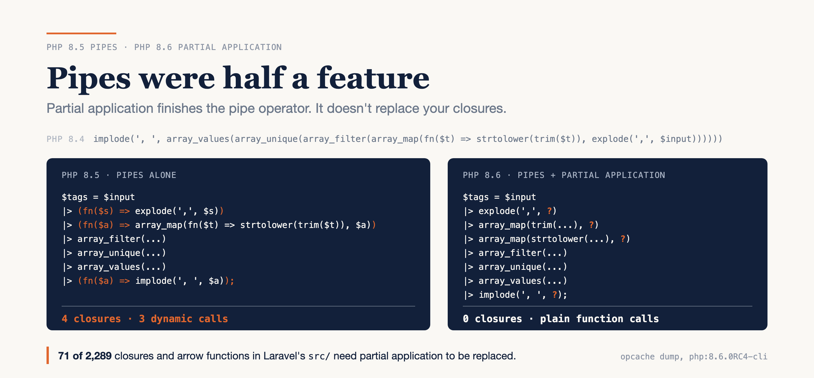

# Pipes Were Half a Feature Until Partial Application Arrived

### I wrote the same pipeline for PHP 8.4, 8.5 and 8.6 and read the opcodes. Then I counted the closures partial application could replace in Laravel: 71 out of 2,289.

*Run on the official `php:8.4-cli`, `php:8.5-cli` and `php:8.6.0RC4-cli` images on 26 October 2026. Counts are from laravel/framework v13.37.0 and symfony/symfony v8.1.9. The 8.6 syntax is frozen, but I'll re-run everything on the GA image after 19 November.*



---

Write a PHP 8.5 pipe the way the pipe RFC's own examples looked when it was voted on, and PHP refuses to run it:

```text
Fatal error: Arrow functions on the right hand side of |> must be parenthesized
```

Fix that and the pipe works, but only nicely for functions that take one argument. Most useful functions take more than one, so on 8.5 a pipeline ends up as a column of wrapped arrow functions.

Here's the honest version, up front. PHP 8.6's partial function application fixes exactly that, and the result isn't only shorter: the engine compiles it down to plain function calls, with no closure created at all. But I also counted, and in Laravel's own source it would replace about 3% of closures. **Partial application finishes the pipe operator; it doesn't replace your closures.**

Here's what follows: one pipeline written three ways, what the engine actually does with each, three gotchas with real output, a count of Laravel and Symfony, and a six-step way to adopt it this week.

---

## One pipeline, three PHP versions

The task is small and very PHP: turn `' php, Laravel ,,pipes, php '` into a clean, de-duplicated tag list. In 8.4 you read it inside-out:

```php
// PHP 8.4: read it from the middle outwards
$tags = implode(', ', array_values(array_unique(array_filter(
    array_map(fn($t) => strtolower(trim($t)), explode(',', $input))
))));
```

PHP 8.5 added the pipe operator. `$x |> f(...)` means `f($x)`, and a chain runs top to bottom. It works perfectly for single-argument functions, which you pass as first-class callables like `array_filter(...)`. Everything else needs wrapping:

```php
// PHP 8.5: top to bottom, but most steps are wrapped
$tags = $input
    |> (fn($s) => explode(',', $s))
    |> (fn($a) => array_map(fn($t) => strtolower(trim($t)), $a))
    |> array_filter(...)
    |> array_unique(...)
    |> array_values(...)
    |> (fn($a) => implode(', ', $a));
```

PHP 8.6 adds **partial function application**. Call a function with `?` in place of an argument and you get back a closure that takes that argument. `?` stands for exactly one argument; `...` stands for all the rest.

```php
// PHP 8.6: partial application fills the gaps
$tags = $input
    |> explode(',', ?)
    |> array_map(trim(...), ?)
    |> array_map(strtolower(...), ?)
    |> array_filter(...)
    |> array_unique(...)
    |> array_values(...)
    |> implode(', ', ?);
```

All three print `string(19) "php, laravel, pipes"`. The older images reject the newer syntax: 8.4 stops at `syntax error, unexpected token ">"` and 8.5 at `unexpected token "?"`. One precedence detail before you start writing these: the pipe binds tighter than comparison and `??`, so `'beep' |> strlen(...) == 4` compares the result, as the RFC shows.

That third block is the one I want to write. Both RFCs were written by Larry Garfield (PFA together with Arnaud Le Blanc), and the pipe RFC's future-scope section already said partial application "would vastly improve the usability of function composition". The PFA vote was **33 to 0**. The pipe itself passed 33 to 7.

---

## What the engine sees: the closures disappear

Readability is the obvious win. The less obvious one shows up in the opcodes. PHP's optimiser will print them if you ask:

```bash
php -d opcache.enable_cli=1 -d opcache.opt_debug_level=0x20000 tags-86.php
```

For the 8.5 version, the main script contains **4 `DECLARE_LAMBDA_FUNCTION`** and **3 `INIT_DYNAMIC_CALL`** opcodes: a closure is built for each wrapped step and then called. The 8.6 version has none. Every step compiles to an ordinary call:

```text
0002 INIT_FCALL 2 112 string("explode")
0003 SEND_VAL string(",") 1
0004 SEND_VAL T2 2
0005 T6 = DO_ICALL
...
0035 T2 = FRAMELESS_ICALL_2(implode) string(", ") T3
```

Both `array_map` calls were even inlined into loops. This isn't an accident of my example. The PFA RFC lists the forms that get compiled away when they sit on the right of a pipe (`foo(?)`, `foo(1, ?)`, `foo(1, a: ?)` and `foo(1, ...)`), and php-src tests them in `Zend/tests/partial_application/pipe_optimization_001.phpt` through `_015.phpt`.

I'm not attaching a benchmark. The claim is narrower and checkable: the 8.6 pipeline creates no closure objects, and you can verify that with one command.

---

## The three gotchas

### 1. Arrow functions in a pipe need parentheses

This is the fatal error from the top of this post. It wasn't in the RFC that was voted on. It came as an erratum dated 28 August 2025: without parentheses, an arrow function swallowed the rest of the chain as its own body, so php-src PR #19533 made the parentheses mandatory. 8.5.12 and 8.6 RC4 both reject `|> fn($s) => trim($s)` at compile time. The RFC's examples were rewritten after the fact (the erratum says they "have all been modified to conform"), so anything copied from an earlier version of it won't even parse.

### 2. A partial evaluates its arguments once, when you create it

An arrow function re-evaluates its body on every call. A partial evaluates the bound arguments immediately:

```php
$partial = label(?, nextId());                 // nextId() runs here, once
$arrow   = fn($name) => label($name, nextId()); // runs on every call

echo $partial('a'), ' ', $partial('b'); // a#1 b#1
echo $arrow('c'), ' ', $arrow('d');     // c#2 d#3
```

If that argument reads a clock, a request or a mutable container, the two lines are different programs.

### 3. `foo(...)` passes extra arguments through; `foo(?)` drops them

This one matters for Laravel code. `Collection::map()` calls `Arr::map()`, which calls your callback as `array_map($callback, $array, $keys)` (`src/Illuminate/Collections/Arr.php:868`). So your callback receives the key as a second argument. An arrow function that declares one parameter ignores it. A first-class callable does not. Run against `illuminate/collections` v13.38.0 on RC4:

```php
$fruit = new Collection(['a' => 'banana', 'n' => 'nan']);

$fruit->map(fn($s) => trim($s)); // ['a' => 'banana', 'n' => 'nan']
$fruit->map(trim(...));          // ['a' => 'banan',  'n' => 'a']
$fruit->map(trim(?));            // ['a' => 'banana', 'n' => 'nan']
```

With `trim(...)`, the key lands in `trim()`'s `$characters` parameter and quietly eats your data. `trim(?)` has exactly one parameter and drops the extra argument, like the arrow function. The RFC warns about the same trap with `intval()` and its `$base` parameter. For callbacks, `?` is the safe spelling.

One more for completeness: pipes reject by-reference functions by design, so `$a |> sort(...)` throws `sort(): Argument #1 ($array) could not be passed by reference`.

---

## I counted: where partial application actually fits

A feature like this invites a big refactor. Before planning one, I wanted to know how many closures in a real codebase partial application could replace, so I parsed two frameworks with `nikic/php-parser` v5.9.0.

The method is a syntactic check on every closure and arrow function. A closure is a candidate when its whole body is a single function, method or static call, and every parameter is passed into that call exactly once, as a bare argument. The core of it, condensed from the script:

```php
// The body must be exactly one call
$call = $fn instanceof Expr\ArrowFunction ? $fn->expr : $fn->stmts[0]->expr;
if (!($call instanceof Expr\FuncCall || $call instanceof Expr\MethodCall
    || $call instanceof Expr\StaticCall)) return 'no';

foreach ($call->args as $arg) {
    $v = $arg->value;
    if ($v instanceof Expr\Variable && array_key_exists($v->name, $params)) {
        $order[] = $v->name;               // a parameter, passed straight through
        continue;
    }
    if (usesAny($v, $params)) return 'no'; // a parameter buried in an expression
    if (!isStable($v)) $eager = true;      // re-evaluated on every call today
}
```

The candidates then split by what the other arguments are:

- **`foo(...)` already works.** The arguments are exactly the parameters, in order. First-class callable syntax has covered this since 8.1.
- **Needs PFA.** The other arguments are literals, constants or variables captured by value, so `foo(?, $min, $max)` is an exact replacement. I include the cases that pass parameters out of order, which need named placeholders like `hasHeader(value: ?, key: ?)`.
- **PFA changes timing.** Some other argument is a property fetch or a call that runs on every invocation today. A partial would run it once (gotcha 2).
- **Neither.** Everything else: multi-statement bodies, nested calls, parameters used twice, `use (&$x)`, constructors.

```text
Closures and arrow functions in non-test code

                      Laravel src/    Symfony src/
Total                  2,289           1,361
foo(...) works           130  5.7%        19  1.4%
Needs PFA                 71  3.1%        71  5.2%
PFA changes timing        26  1.1%         4  0.3%
Neither                2,062 90.1%     1,267 93.1%

Laravel v13.37.0, Symfony v8.1.9
```

The candidates look exactly like what you'd expect. `array_map(fn ($group) => static::collapse($group, $min, $max), $groups)` in `CronExpressionTimezoneConverter.php:283` becomes `static::collapse(?, $min, $max)`. `->map(fn ($property) => sprintf('<fg=gray>%s</>', $property))` in `ShowModelCommand.php:114` becomes `sprintf('<fg=gray>%s</>', ?)`. I hand-checked 20 random Laravel candidates and all 20 were genuine.

Two things in that table surprised me. First, Laravel has **130** closures and arrow functions that could have been first-class callables since 8.1 shipped in 2021, and weren't. Gotcha 3 is a good reason to leave them wherever they're passed to `Collection::map()`, because there they'd receive the key. For those, `foo(?)` is the spelling 8.6 adds that is actually safe. Second, the "neither" column is 90% or more in both frameworks. Most closures in real code exist because they do something, not because a call needed an adapter.

---

## Playbook: adopting pipes and partial application this week

### 1. Get an image that runs it

`docker run --rm -v "$PWD":/app -w /app php:8.6-rc-cli php your-script.php`. The 8.6 RC image ships without `mbstring` (`extension_loaded('mbstring')` returns `false`), so install it or leave `mb_*` out of your probe.

### 2. Rewrite your longest nested-call chain as a pipe

Use `foo(...)` for single-argument steps and `foo(?)` with the other arguments filled in for the rest. If a step still needs a wrapped arrow function, that's the step to look at twice.

### 3. Grep for unparenthesised arrow functions after `|>`

`grep -rnE '\|>\s*(static\s+)?fn' src/` matches only the unparenthesised form, so every hit is a line that won't compile.

### 4. Prefer `foo(?)` to `foo(...)` for callbacks

Anywhere the caller may pass extra arguments (`Collection::map()`, `array_filter()` with `ARRAY_FILTER_USE_BOTH`, `array_walk()`), `?` keeps the closure's arity at one.

### 5. Only bind arguments that are safe to evaluate once

A literal, a constant or a local variable is fine. `$this->now()` or `$request->input('x')` is not, unless once is what you want.

### 6. Count before you plan a refactor

Run the four-bucket check above over your own `src/`. The cost: the counter parsed and classified Laravel's 1,742 `src/` files in 22 seconds inside the container, so the count is the cheap part. If your "needs PFA" share is in the low single digits, as it was in both frameworks, the job is a handful of hand edits as you touch the code, not a project.

---

## The limits

This is RC4, not GA, though the syntax is frozen and nothing changed between RC3 and RC4 in my runs. The count is a syntactic heuristic. It doesn't know function signatures, so it can't flag the arity trap from gotcha 3 or the fact that a partial takes its parameter types from the target function, not from the closure you're replacing. It is conservative about "timing": anything beyond a literal, a constant or a captured variable counts as evaluated per call, even `strlen($relationName) + 1`. Two frameworks aren't a survey, and both still support versions without pipes (`"php": "^8.3"` and `">=8.4.1"`), so neither can use any of this yet. And per the RFC, partial application doesn't work on constructors (`new`) or on scope-reading functions like `compact()` and `extract()`.

---

## Verdict

Pipes were half a feature; partial application is the other half.

In 8.6 a pipeline reads top to bottom, needs no wrapping, and compiles to the same calls you'd have written by hand. That's a genuinely good result. The numbers say what it isn't: a reason to rewrite your closures. In Laravel and Symfony, partial application replaces 3–5% of them, and the rest are doing real work.

So take your longest nested-call chain this week and rewrite it as a pipe on the RC image. If every step becomes `foo(?)` or `foo(...)`, adopt the style for new code. If you still need a wrapped arrow function every other line, your code isn't pipe-shaped, and you lose nothing by waiting.

---

### Sources

- [RFC: Pipe operator v3](https://wiki.php.net/rfc/pipe-operator-v3) — PHP wiki (vote 33–7; errata of 28 August 2025)
- [RFC: Partial Function Application v2](https://wiki.php.net/rfc/partial_function_application_v2) — PHP wiki (vote 33–0)
- [php-src PR #19533: require parentheses around arrow functions in pipes](https://github.com/php/php-src/pull/19533) — GitHub
- [php-src `Zend/tests/partial_application/`](https://github.com/php/php-src/tree/PHP-8.6/Zend/tests/partial_application) and [`Zend/tests/pipe_operator/`](https://github.com/php/php-src/tree/PHP-8.6/Zend/tests/pipe_operator) — GitHub
- [Functional operators](https://www.php.net/manual/en/language.operators.functional.php) — PHP manual
- [`Arr::map()` in laravel/framework v13.37.0](https://github.com/laravel/framework/blob/v13.37.0/src/Illuminate/Collections/Arr.php#L863-L873) — GitHub
- [nikic/php-parser](https://packagist.org/packages/nikic/php-parser) — Packagist
